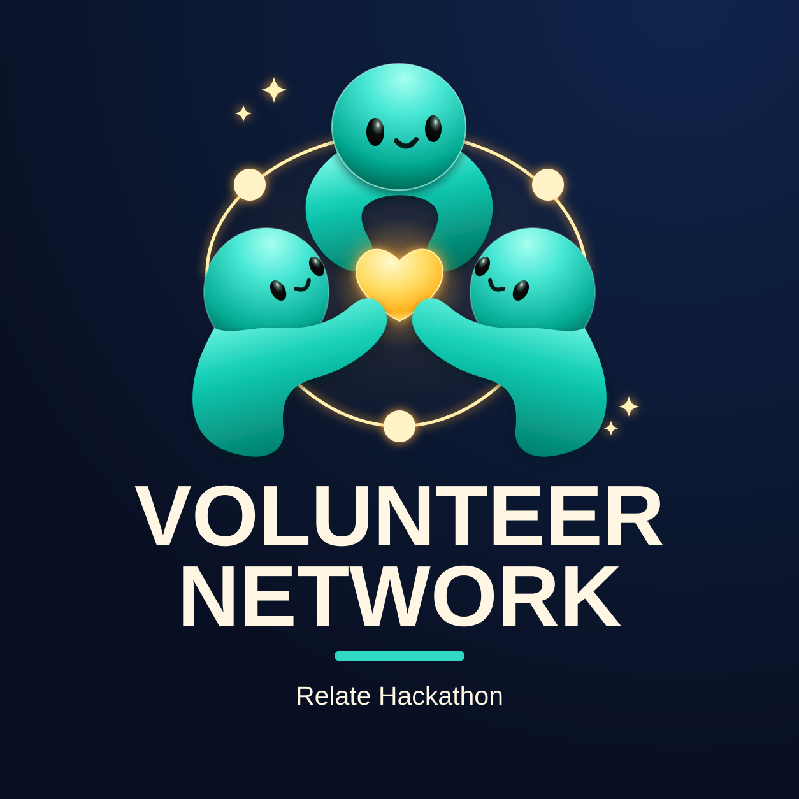

<h1 align="center">Changelog</h1>

<em>Volunteer Network · what changed, release by release</em>

<a href="README.md">README</a> ·
<a href="CONTRIBUTING.md">Contributing</a> ·
<a href="CODE_OF_CONDUCT.md">Code of conduct</a>

Generated from the commit messages by `uv run task changelog` (git-cliff, cliff.toml).

---
## Unreleased

### Changed

- fix graph-read truncation and Aura push, split services and web, scope the sweep
- declare API responses, restructure the admin console, tidy the mobile app
- to add Showcse for charities

### Documentation

- describe the new module layout and record the refactor's verification
- document how the application uses Relate, list all tooling, fix stale statements

### Chores

- merge remote initial commit, keep project LICENSE
- Bump nginxinc/nginx-unprivileged in /docker in the images group (#1)
- Replace @demo.invalid demo addresses with @cyberscallywags.uk
- build separate web and admin images, run CI once per pull request

### Other

- Initial Commit
- Initial commit
- Refactor/theme images (#4)
