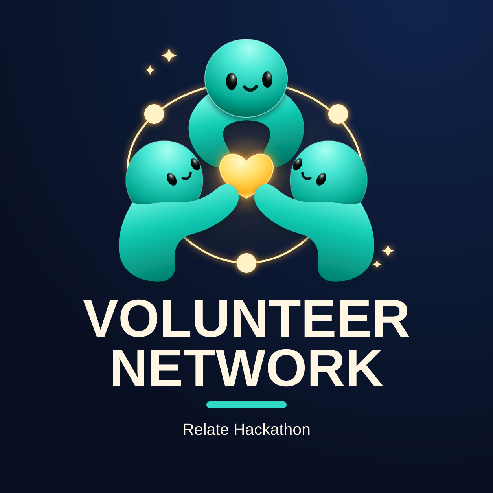

  

<h1 align="center">Code of conduct</h1>

  <em>Volunteer Network · a welcoming space for everyone who helps</em>

  
  

  <a href="README.md">README</a> ·
  <a href="CONTRIBUTING.md">Contributing</a> ·
  <a href="CHANGELOG.md">Changelog</a>

---

This project adopts the [Contributor Covenant, version 2.1](https://www.contributor-covenant.org/version/2/1/code_of_conduct/)
as its code of conduct.

| We ask you to | We do not accept |
|---|---|
| Be welcoming and kind | Harassment |
| Accept constructive criticism gracefully | Insults |
| Focus on what is best for the community | Publishing other people's private information |

This applies in every project space, and in public when you represent the project.

## Reporting

> [!IMPORTANT]
> Report behaviour that breaks this code **privately** to the project's maintainers. Reports are
> handled in confidence.

You can report through either:

- the repository's **Security → Report a vulnerability** form (only maintainers can read it), or
- GitHub's [report content](https://docs.github.com/en/communities/maintaining-your-safety-on-github/reporting-abuse-or-spam)
  tools.

## Enforcement

Maintainers apply the Covenant's
[enforcement guidelines](https://www.contributor-covenant.org/version/2/1/code_of_conduct/#enforcement-guidelines),
depending on the impact:

1. Correction
2. Warning
3. Temporary ban
4. Permanent ban

---

  Cyber Scallywags · Volunteer Network

