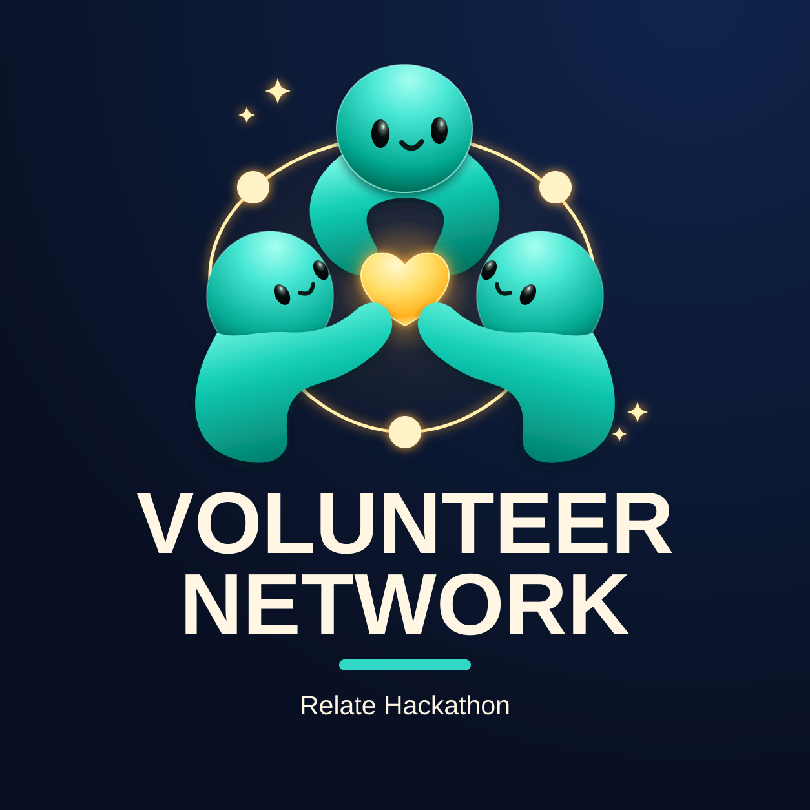

  

<h1 align="center">Contributing</h1>

  <em>Volunteer Network · thanks for helping</em>

  
  
  

  <a href="README.md">README</a> ·
  <a href="CODE_OF_CONDUCT.md">Code of conduct</a> ·
  <a href="SECURITY.md">Security</a> ·
  <a href="CHANGELOG.md">Changelog</a>

---

Please follow the [Code of conduct](CODE_OF_CONDUCT.md) and report security problems as described
in [SECURITY.md](SECURITY.md).

## Workflow

1. **Set up**: `uv sync --locked`, then `uv run pre-commit install`.
2. **Branch** from `main` using one of the prefixes below. The hooks refuse commits to `main` and
   badly named branches.
3. **Commit** with one of the prefixes below (see `scripts/check_commit_msg.sh`).
4. **Check** with `uv run task lint` and `uv run task test` (`uv run task hooks` runs every
   pre-commit hook on every file). For mobile changes, also run
   `docker build -f docker/mobile.Dockerfile --target test .` (or `npm run lint && npm run
   test:ci` in `mobile/`).
5. **Fixtures**: if you edit `data/fixtures/*.json`, run `uv run task bundle` to rebuild
   `data/demo.rl`. A test fails if the bundled store drifts from the fixtures.
6. **Docs**: pages live in `docs/content`. Build them with `uv sync --locked --group docs` and
   `uv run task docs`; warnings fail the build. A new page goes in both `docs/zensical.toml`
   (`nav`) and `docs/content/manual.md` (a `toctree`).

Every tool, task and hook is listed in
[docs/content/project/tooling.md](docs/content/project/tooling.md). How the application uses
the Relate graph engine is in [docs/content/project/relate.md](docs/content/project/relate.md).

## Naming

**Branches** start with `feature/`, `bug/`, `task/`, `docs/` or `refactor/`.

**Commits** start with a prefix, which decides where they land in the [Changelog](CHANGELOG.md):

| Commit prefix | Changelog section |
|---|---|
| `ADDED:` | Added |
| `FIXED:` | Fixed |
| `REFACTOR:` | Changed |
| `DOCS:` | Documentation |
| `TASK:` | Chores |

> [!WARNING]
> Keep demo data fictional. Never commit credentials, `.env` or anything under `var/`.

---

  Cyber Scallywags · Volunteer Network

