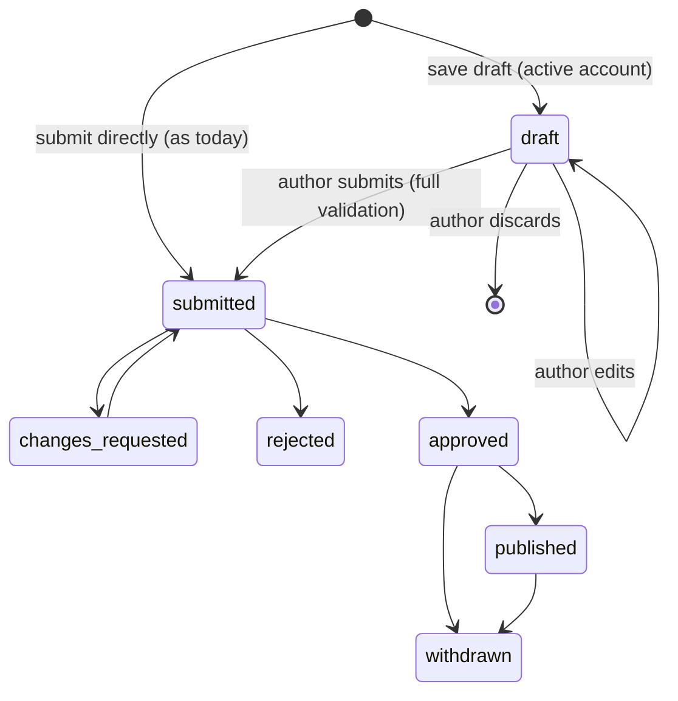

# Proposal: draft state for project suggestions (issue #24)

Status: **implemented** (all section 7 recommendations taken as proposed).
Branch: `refactor/24-refactor-project-flow-to-allow-drafts`

## 1. What changes for users

Today a suggestion is created and sent to the organisation's reviewers in one step
(`create_submission` inserts it as `submitted` and notifies the org admins). There is nowhere to
stop halfway.

Proposed: a suggestion can be **saved as a draft**, edited any number of times, and only goes to
the organisation's reviewers when the author chooses **Submit for review**.

| | Draft | Submitted (unchanged) |
|---|---|---|
| Who can see it | the author only | the author and the organisation's reviewers |
| In the review queue and review counts | no | yes |
| Org admins notified | no | yes, at the moment of submission |
| Content rules | title only; everything else may be incomplete | full validation, as today |
| Author can edit | yes, in place | no (only after "changes requested") |
| Author can discard | yes (row deleted) | no |

Submitting in one step, without saving a draft first, still works exactly as it does now.

## 2. State machine

Everything from `submitted` onwards is untouched.

## 3. Design decisions

1. **`draft` is a new value of `submissions.state`**, not a separate table. Lists, the
   `submission_current` view and the detail page already work from that column.
2. **A draft is edited in place as revision 1.** Saves overwrite the revision row and its skills
   and bump `version` (the existing optimistic-concurrency check). Revision history starts at
   submission, so reviewers still see "revision 1" first.
3. **Partial content is allowed in a draft.** A title (3–120 characters) and a target organisation
   are required, because every list and the view need them. Summary, cause and skills may be
   empty, but anything supplied must still be a valid catalogue id and within length limits. Full
   `Draft.validate()` runs at submission.
4. **Permissions are checked twice.** Saving a draft needs an active account with access to the
   organisation, as creating a suggestion does today. Submission re-checks both, since either can
   change while the draft sits there.
5. **Drafts are private to the author.** A reviewer who guesses the URL gets the same 404 as any
   other stranger.
6. **The target organisation can be changed while it is a draft**, and is fixed once submitted.
7. **The API keeps `POST /submissions` as create-and-submit**, so the mobile app and existing
   clients are unaffected. Drafts get their own endpoints (section 4.3).
8. **Discard is a hard delete.** Nothing references a draft: no reviews, placements, outbox items
   or notifications exist for it.

## 4. Code changes

### 4.1 Database: [src/app/sqlstore.py](src/app/sqlstore.py)

- [`submissions.state` CHECK](src/app/sqlstore.py#L119-L121): add `'draft'`.
- [`submission_revisions.cause_id`](src/app/sqlstore.py#L141): drop `NOT NULL`, so a draft can be
  saved before a cause is chosen. `summary` stays `NOT NULL` and holds `''`.
- [`SCHEMA_VERSION`](src/app/sqlstore.py#L248): 2 → 3.

There are no migrations in this project: an existing database stops with `SchemaOutdated` and is
rebuilt with `uv run task reset` (or `docker compose down -v`). That is the current convention,
but it does mean **existing local and Compose data is wiped**.

### 4.2 Services: [src/app/services/submissions.py](src/app/services/submissions.py)

| Where | Change |
|---|---|
| [`PROJECT_STATES`](src/app/services/submissions.py#L22-L29) | add `"draft": "Draft: not yet submitted"` |
| [`Draft.validate`](src/app/services/submissions.py#L41-L56) | add a `complete: bool = True` mode; `complete=False` applies the partial rules in decision 3 |
| [`_insert_revision`](src/app/services/submissions.py#L59-L70) | accept an empty cause (stored as NULL); add a small `_replace_revision` for in-place draft saves |
| [`create_submission`](src/app/services/submissions.py#L73-L91) | unchanged behaviour; shares its insert with the new `save_draft` |
| new `save_draft(db, user_id, org_id, draft) -> sid` | inserts with state `draft`; no notifications |
| new `update_draft(db, user_id, sid, org_id, draft, *, expected_version)` | author + state `draft` + version check; otherwise `NotFound` / `Conflict` |
| new `submit_draft(db, user_id, sid, *, expected_version)` | full validation, re-checks active + org access, `draft → submitted`, then the same two notifications `create_submission` sends today |
| new `discard_draft(db, user_id, sid, *, expected_version)` | deletes skills, revision and submission rows |
| [`get_submission`](src/app/services/submissions.py#L141-L184) | a draft is visible to its author only; add `can_edit` (author and state `draft`) to the returned flags |
| [`review_queue`](src/app/services/submissions.py#L201-L213) | add `AND s.state != 'draft'` |
| `review_counts`, `review_submission`, `withdraw_project`, `set_project_lead`, `published_state` | no change: each already filters on a specific later state |

Also export the four new functions from [src/app/services/__init__.py](src/app/services/__init__.py).

### 4.3 JSON API: [src/app/web/api.py](src/app/web/api.py#L289-L320) and [src/app/web/schemas.py](src/app/web/schemas.py)

New endpoints, all author-only:

| Endpoint | Does |
|---|---|
| `POST /submissions/drafts` | save a new draft → `{id, state: "draft"}` |
| `PUT /submissions/{sid}/draft` | update a draft (body carries `version`) |
| `POST /submissions/{sid}/submit` | submit a draft for review (body carries `version`) |
| `DELETE /submissions/{sid}` | discard a draft (`version` as a query parameter) |

Schema changes:

- [`SubmissionState`](src/app/web/schemas.py#L16-L18): add `"draft"`.
- New `DraftSaveIn` (as `DraftIn` but `summary`, `cause_id` and `required` default to empty, plus
  `org_id`), `DraftUpdateIn` (adds `version`) and `VersionIn`.
- [`Revision.cause_id`](src/app/web/schemas.py#L300-L307): `str` → `str | None`.
- [`Submission`](src/app/web/schemas.py#L319-L342): add `can_edit: bool`.

### 4.4 Web pages

| File | Change |
|---|---|
| [pages/suggestions.py](src/app/web/pages/suggestions.py#L48-L80) | `POST /submissions/new` reads `intent` (`save` or `submit`) from the pressed button. `GET /submissions/{sid}` renders the edit form when the suggestion is the viewer's draft. New `POST /submissions/{sid}/draft` (save or submit, by `intent`) and `POST /submissions/{sid}/discard`. |
| [templates/submission_form.html](src/app/web/templates/submission_form.html) | two buttons, **Save draft** (`formnovalidate`, so the browser's `required` checks don't block a partial save) and **Submit for review**; in edit mode it posts to `/submissions/{sid}/draft`, carries `version` and shows **Discard draft** |
| [templates/macros.html](src/app/web/templates/macros.html#L32-L60) | `draft_fields`: add an empty "Choose a cause" option so an unset cause round-trips |
| [templates/submission.html](src/app/web/templates/submission.html) | no draft branch needed (drafts render the form), but guard the cause line against a NULL cause |
| [templates/submissions.html](src/app/web/templates/submissions.html), [home.html](src/app/web/templates/home.html#L30-L32) | work as-is through the `state_label` filter; drafts link to the edit form |
| [deps.py](src/app/web/deps.py#L38) | flash messages `draft_saved` and `draft_discarded` |
| [static/style.css](src/app/web/static/style.css#L74) | `.state.draft` (muted) |

### 4.5 Profile view: [src/app/profile_view.py](src/app/profile_view.py#L23-L24)

A draft is in neither `ACTIVE_STATES` nor `PAST_STATES`, so it would silently drop out of the
profile's project lists. I propose leaving it that way (drafts appear under *My suggestions* and
on the home page only), and saying so in a comment.

### 4.6 Mobile: [mobile/src/app/core/api.types.ts](mobile/src/app/core/api.types.ts#L76)

Add `'draft'` to the `Submission.state` union. The list page shows the server's `state_label`, so
drafts appear as "Draft: not yet submitted" with no page change. Creating and editing drafts stays
web-only, in line with the existing "feedback and revision happen in the web app" comment.

### 4.7 Not affected

Graph projection ([graph/projector.py](src/app/graph/projector.py), [graph/cypher.py](src/app/graph/cypher.py)):
only `approved` suggestions are enqueued. Placements, matching, vetting, the admin console
([admin/main.py](src/app/admin/main.py)) and the seed loader ([runtime.py](src/app/runtime.py#L159-L186)) need no change.

## 5. Tests

| File | Add or update |
|---|---|
| [tests/test_submissions.py](tests/test_submissions.py) | save a partial draft; edit it; stale `version` → conflict; draft invisible to reviewers (queue, counts, direct URL); no admin notification until submit; submit runs full validation and fails on an incomplete draft; submit blocked after losing org access or active status; discard removes it; only the author can edit, submit or discard; a submitted suggestion cannot be edited or discarded as a draft |
| [tests/test_web_pages.py](tests/test_web_pages.py) | both form buttons; draft page renders the form pre-filled; validation error on submit keeps the entered values |
| [tests/test_api_contract.py](tests/test_api_contract.py#L239-L242) | new endpoints in the contract; the mobile-union regex anchors on `'submitted'` being first, so either keep that order or anchor it on `'draft'` |
| [tests/test_rbac_onboarding.py](tests/test_rbac_onboarding.py) | API flow: draft → update → submit → decision |
| [tests/test_sqlstore.py](tests/test_sqlstore.py) | `submission_current` returns drafts with their title |
| [mobile/.../submissions.page.spec.ts](mobile/src/app/pages/submissions/submissions.page.spec.ts), [fixtures.ts](mobile/src/app/testing/fixtures.ts#L33) | a draft row in the fixture |

Done means `uv run task verify` passes, per the issue.

## 6. Documentation

- [docs/content/project/solution-architecture.md](docs/content/project/solution-architecture.md#L505-L530) §7.5: state diagram and table; the schema-version note at line 665.
- [README.md](README.md#L199): API table, plus the roles table line for volunteers.
- [docs/content/project/verification.md](docs/content/project/verification.md#L42): the Suggestions row.
- `docs/content/project/solution-architecture.pdf` will be out of date; I can't regenerate it
  unless there is a task for that.
- `CHANGELOG.md` is generated by git-cliff, so it is left alone.

## 7. Decisions for you

| # | Question | My recommendation |
|---|---|---|
| 1 | Bump the schema version and wipe existing data (4.1)? | Yes, unless any environment holds data worth keeping. If one does, I'd write a one-off migration instead. |
| 2 | How incomplete may a draft be (decision 3)? | Title + organisation required, the rest optional. |
| 3 | Should "changes requested" revisions also be saveable as drafts? | Not in this change. It needs a pending-revision concept and the issue only asks for the pre-submission step. |
| 4 | Add a draft suggestion to the demo seed ([data/fixtures/demo.json](data/fixtures/demo.json))? | Yes, one for Asha, so the demo shows the state. It changes the seeded counts some tests assert on. |
| 5 | Show drafts on the profile's project list (4.5)? | No. |
| 6 | Expire abandoned drafts in `prune`? | No. They are small and private; revisit if they pile up. |
| 7 | Rename the `services.Draft` dataclass, now that "draft" is also a state? | No. It is used in 12 places and still describes the same thing: unreviewed suggestion content. |

## 8. Order of work

1. Schema and services, with service-level tests.
2. JSON API, schemas and contract tests.
3. Web pages and templates, with page tests.
4. Mobile type and fixture.
5. Docs, then `uv run task verify`.
