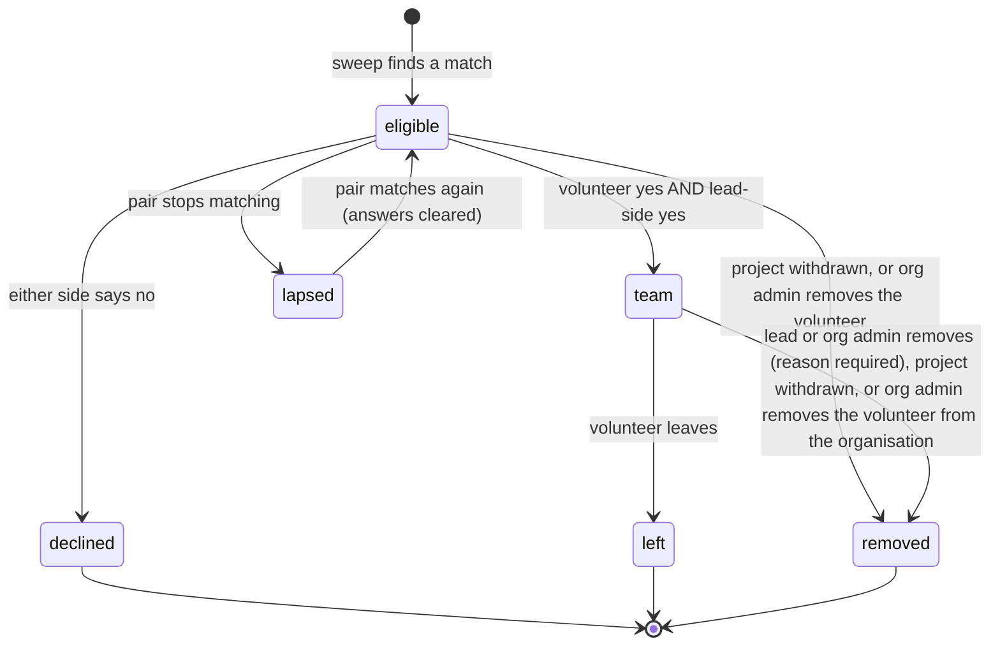

# Matching and placement review

Reviewed 19 November 2026. Scope: how a volunteer is matched to a project, how the two
acceptances (volunteer, and project lead or org admin) put them on the team, and where that
delegation falls short. Files read: `src/app/placements.py`, `matching.py`, `graph/cypher.py`,
`graph/projector.py`, `runtime.py`, `services/` (access, orgs, submissions, vetting), `notify.py`,
the placement routes in `web/api.py` and `web/pages/projects.py`, and the related templates and
tests.

No production code was changed. Every finding marked **Confirmed** was reproduced with a
throwaway test against the demo seed (through the JSON API, the same way
`tests/test_rbac_onboarding.py` works); the test file was deleted afterwards. Findings marked
**By reading** follow from the code and were not run.

## Status of each finding

Implemented on 22 November 2026 on the branch `feature/matching-review`, with the team's answers
to the questions in section 4:

| Question | Answer | What was built |
|---|---|---|
| Is an org admin's yes a substitute for the lead's? | Yes | Unchanged: either may give the lead-side answer. Who gave it is now recorded. |
| Is a lead automatically on their own team? | Yes | The lead is put on the team when the project is projected, with no second person. |
| Is one matching skill enough for an offer? | The lead chooses who is invited from the ranked list | A match makes a candidate, shown ranked to the lead side only. The lead invites; the volunteer then answers. |
| Should anyone be told when a team member stops matching? | No, only while the placement is still open | Unchanged: an open candidate or invitation lapses; a team member stays. |
| Should suspension take a volunteer off their teams? | Yes | Suspension ends team places and open offers. |

The rest of this document is the review as written, so sections 1 and 2 describe the code
**before** these changes. The current flow is in the docstring of `src/app/placements.py` and in
section 7.4 of `docs/content/project/solution-architecture.md`.

| # | Finding | Status |
|---|---|---|
| 1 | Team members outlive their standing | **Fixed.** Suspension, leaving an organisation and removal from it all end team places and close open offers (`services/teams.py`). The lead is told. |
| 2 | Lead authority outlives standing | **Fixed.** The lead must be active and still with the organisation, or be an org admin. Org admins are told when a project is left without an active lead. |
| 3 | One person can supply both acceptances | **Fixed.** Nobody gives the lead-side answer on their own placement. The lead is the one exception, by the team's decision, and it is recorded as automatic. |
| 4 | Declined, left and removed are permanent | **Fixed for the lead side.** The lead or an org admin can reopen a closed placement; the volunteer becomes a candidate again if they still match. A volunteer cannot reopen one themselves, and there is still no way to invite someone who does not match. |
| 5 | No capacity or per-skill places | **Partly.** Offers no longer go to every match: the lead invites from the ranked list, and gets one notification per project for new candidates. A team size or a number of places per skill was not added. |
| 6 | The lead decides with little information | **Fixed.** Preferred cause and optional skills are stored, the table is in ranked order, and an open candidate's skills are refreshed on every sweep. |
| 7 | Org admins are not told | **Fixed.** Candidate and team notifications go to the org admins whenever the project has no active lead, and to the admin who sent an invitation. |
| 8 | No record of who answered | **Fixed.** `lead_actor_id`, answer times and an optional reason are on the placement, and every change is a row in `placement_events`. The lead's table shows "Decided by"; the full history has no screen yet. |
| 9 | Offers never expire | **Fixed for invitations.** One reminder after `INVITATION_REMINDER_DAYS` (7), closed after `INVITATION_EXPIRY_DAYS` (14), which returns the volunteer to the candidate list. Candidates the lead has not acted on are not chased. |
| 10 | Coverage, matches and team unconnected | **Fixed.** `TEAM_COVERAGE` reads the `ON_TEAM` edges; the coverage table has an "On the team" column and counts a skill as covered only then. Candidates show their status, and "My matches" shows invited, on the team, declined, left or removed. |
| 11 | Lead change does not carry over | **Fixed.** The new lead joins the team and is told the project's name and how many candidates are waiting; the former lead is told and keeps the team place they had. |
| 12 | Shared version number | **Not changed.** The two sides now answer in turn (invite, then accept), so the collision described no longer arises. Refreshing a candidate's skills and sending a reminder do not bump the version. |
| 13 | Answers not re-checked | **Fixed.** A yes checks, in the same transaction, that the project is published and the volunteer is active and opted in. |
| 14 | Pages and API disagree | **Fixed.** The volunteer's answer is final on both. The lead side can withdraw an open invitation on both, with an optional reason. |
| 15 | Test coverage | **Done.** `tests/test_placement_rules.py` has a test per finding (19 tests). |

Things to know before running it:

- **The SQLite schema version went from 3 to 4** (new placement columns and the
  `placement_events` table). An existing data directory is refused at start-up; reset it with
  `uv run task reset`.
- The bundled demo graph `data/demo.rl` was rebuilt: project leads are now on their teams, so it
  has 5 `ON_TEAM` edges where it had 1.
- New API route: `POST /api/v1/projects/{project_id}/placements/{volunteer_id}/reopen`. The
  placement, match and coverage responses gained fields; none was removed.

## Summary

The core two-sided flow works as documented: the graph decides who is eligible, each eligible
pair becomes a placement, and the volunteer joins the team only when the volunteer side and the
lead side have both said yes. Stale forms are rejected, withdrawal of a project and removal by an
org admin clean up properly, and every transition notifies the volunteer.

The shortcomings are around the edges of that flow:

| # | Finding | Severity | Status |
|---|---|---|---|
| 1 | A suspended volunteer, or one who leaves the organisation, stays on the team | High | Confirmed |
| 2 | A lead who has left the organisation or been suspended can still see candidates and accept them | High | Confirmed |
| 3 | One person can supply both acceptances (org admin for themselves; a former lead keeps an automatic yes) | High | Confirmed |
| 4 | Declined, left and removed are permanent: the pair is never offered again and nobody can reopen it | High | Confirmed |
| 5 | No capacity or per-skill places: one matching skill is enough, and every match is offered | Medium | Confirmed |
| 6 | The lead decides with little information: ranking is discarded and matched skills go stale | Medium | By reading |
| 7 | Org admins can answer for the lead but are never told there is anything to answer | Medium | Confirmed |
| 8 | No record of who answered for the lead side, when, or why | Medium | By reading |
| 9 | Offers never expire and nobody is reminded | Medium | By reading |
| 10 | Coverage, matches and the team are three unconnected views; the `ON_TEAM` edge is never read | Medium | Confirmed |
| 11 | Changing the lead does not carry over to open placements | Medium | Confirmed |
| 12 | The two sides share one version number, so independent answers collide | Low | Confirmed |
| 13 | An answer is not re-checked against membership or project state | Low | Confirmed |
| 14 | The web pages and the API disagree about changing an answer | Low | Confirmed |
| 15 | None of the cases above has a test | Low | By reading |

## 1. What happens today

### 1.1 When a match is made

Matching is not run on a timer or on request. It runs after the graph has caught up with a change
in SQLite:

1. A change is committed in SQLite and an outbox item is queued in the same transaction. The
   changes that queue one are: a profile save, joining or leaving an organisation, a vetting
   decision, a project approval or withdrawal, a team change, and a catalogue or organisation
   change.
2. The projector drains the outbox and reconciles the graph (`graph/projector.py`). The pages and
   the API call `drain` straight after each action, so this is normally immediate; the
   background loop, a restart and `cli drain` pick up anything that failed.
3. After a drain that projected something, the hook wired in `runtime.py:36` calls
   `placements.sweep` (`placements.py:108`). The sweep is scoped to the volunteers and projects
   that just changed; a catalogue or organisation change, a replay, or a previously failed sweep
   makes it look at everything.

The sweep asks the graph the same question as every other screen, `MATCH_CANDIDATES`
(`graph/cypher.py:154`). A volunteer and a project are a match when all of these hold:

| Rule | Where it is enforced |
|---|---|
| The project is published | `p.status = 'published'` in the graph, re-checked against SQLite in the sweep |
| The volunteer is opted in to the project's organisation **and** their account is active | The `VOLUNTEERS_WITH` edge exists only then (`projector.py:199`); re-checked against SQLite in the sweep (`placements.py:127`) |
| The volunteer has not excluded the project's cause | `NOT (v)-[:EXCLUDES_CAUSE]->(c)` |
| The volunteer has not excluded any required skill of the project | `NOT EXISTS { ... EXCLUDES_SKILL ... }` |
| The volunteer both has and offers **at least one** required skill | `cypher.py:161-162` |

Preferred cause, the number of required skills covered and optional skills only affect ranking on
the matches and coverage screens. They play no part in whether a placement is created.

For each matching pair the sweep then does one of three things:

- **No placement yet:** insert one in state `eligible`, storing the matched skills. Notify the
  volunteer ("You are eligible… Say yes to join") and the project lead ("X is eligible… Accept or
  decline them").
- **Placement is `lapsed`:** set it back to `eligible`, clear both answers, and notify again.
- **Placement is in any other state:** leave it alone (`placements.py:130`).

A pair that is `eligible` but no longer matches becomes `lapsed`, and the volunteer is told the
offer has closed. If the volunteer is also the project's lead, the lead side is filled in as yes
automatically (`placements.py:133`).

### 1.2 How the two acceptances are used

A placement row holds two answers, `volunteer_said` and `lead_said`, each empty, `yes` or `no`
(`sqlstore.py:177`). Both kinds of answer go through one function, `_respond`
(`placements.py:174`):

- The placement must be `eligible` and the caller's `version` must match the row's, otherwise the
  answer is refused with "This offer has changed since you opened it."
- Any no, from either side, ends it: state `declined`.
- Yes from both sides: state `team`. The project is queued for projection, which writes the
  `(:Volunteer)-[:ON_TEAM]->(:Project)` edge.
- One yes and one empty answer: stays `eligible`, and the other party is told.

Who may give each answer:

| Side | Who | Check |
|---|---|---|
| Volunteer | The volunteer themselves, for their own placement only | `volunteer_respond` (`placements.py:234`): the account must be active |
| Lead | The project's `lead_id`, **or** any org admin of the project's organisation, **or** a system admin (who holds every organisation role) | `_check_lead` (`placements.py:242`) |

The org admin is therefore not a third approval. An org admin's answer is recorded in the same
`lead_said` column as the lead's, and whichever of them answers first settles the lead side. The
lead is the author of the project suggestion unless an org admin reassigns it
(`services/submissions.py:340`).

### 1.3 Placement states

`declined`, `left` and `removed` have no way out. `team` is left only by an explicit action; the
module's own description says "Team members are never removed by a sweep."

### 1.4 What holds up well

- One code path for both sides and for both the pages and the API, so the rules cannot drift.
- Stale and replayed forms are refused by the version check.
- Withdrawing a project and removing a volunteer from an organisation both end the affected
  placements, notify the volunteer and remove the `ON_TEAM` edge.
- The sweep never lapses an offer on a partial graph read; it fails and is retried in full.
- Other volunteers cannot answer for the lead, another organisation's admin gets "not found", and
  candidate lists carry display names only.

## 2. Shortcomings

### High

**1. A suspended volunteer, or one who leaves the organisation, stays on the team.** *Confirmed.*
Suspending a team member removes their `VOLUNTEERS_WITH` edge, but the placement stays `team` and
the `ON_TEAM` edge stays in the graph. The same happens when a team member leaves the
organisation themselves (`services/orgs.py:18` only flips the membership). After leaving they can
no longer open the project page, yet they are still on its team. Only removal *by an org admin*
(`services/orgs.py:55`) cleans up. The "sweeps never remove team members" rule is reasonable for a
skill change, but suspension and leaving the organisation remove the basis for being on the team
at all.

**2. A lead's authority is not tied to their standing.** *Confirmed.* `_check_lead` passes anyone
whose ID equals `lead_id`, before looking at their access. A lead who has left the organisation
can still list the project's candidates by name and answer for the lead side through the API
(the web page is blocked by its own access check, the API is not). A suspended lead can do the
same. Nothing clears or flags `lead_id` when the lead leaves, is removed or is suspended, so a
project can also be left with a lead who will never answer.

**3. One person can supply both acceptances.** *Confirmed.* Two routes:

- An org admin who is also a volunteer in that organisation can say yes as the volunteer and then
  yes as the lead side for their own placement, and is on the team with no second person involved.
- The automatic lead-side yes for the lead's own placement is never revisited. After the lead is
  changed, the former lead still holds that yes and joins on their own word alone, while the new
  lead's own placement has an empty lead side that only they or an org admin can fill.

A lead being on their own project is sensible. The gap is that nothing distinguishes it from an
admin approving themselves, and nothing records it.

**4. Declined, left and removed are permanent.** *Confirmed.* The sweep skips any existing
placement that is not `lapsed`, so:

- A volunteer who clicks "No thanks" by mistake can never be offered that project again.
- A lead's decline cannot be reversed, by the lead or by an org admin.
- A volunteer who leaves a team cannot rejoin it.
- A volunteer removed from an organisation who later rejoins it is matchable again in the graph,
  but their old placements stay `removed`, so they are never offered those projects.

There is no manual path either: a lead cannot invite or add a volunteer, and a volunteer cannot
ask to join a project. Everything depends on the sweep creating a row.

### Medium

**5. No capacity and no per-skill places.** *Confirmed.* One required skill is enough for an
offer. In the demo, three of the four Food Bank candidates match one of its two required skills.
A project has no team size and no number of people wanted per skill, so every match is offered
and the lead can accept all of them. Nothing shows when the required skills are covered, and
nothing stops a team of five data analysts and no bookkeeper. At scale each match is also a
separate notification to the lead.

**6. The lead decides with little information.** *By reading.* `MATCH_CANDIDATES` returns the
preferred-cause flag, required coverage, optional skills offered and skills still missing. The
sweep keeps only the matched skill list. The lead's table (`placements.py:311`) is ordered by
state and then name, and shows matched skills and the two answers. The stored skill list is also
a snapshot: it is refreshed only when a placement lapses and revives, so a volunteer who adds a
second required skill while the offer is open still shows the first one only.

**7. Org admins can answer but are not told.** *Confirmed.* Placement notifications go to
`lead_id` only. An org admin learns of a waiting candidate only by opening the project page. A
helper that notifies org admins already exists (`notify.py:17`, it is used for project
suggestions) but placements do not call it. Combined with finding 2, a project whose lead is
inactive stalls silently.

**8. No record of who answered for the lead side.** *By reading.* `lead_said` holds yes or no.
It does not hold who answered (the lead, an org admin or a system admin), when, or why. A decline
by the lead needs no reason, although a removal does, and the volunteer is told only that the lead
"has not taken your place this time". Vetting and project review both keep an event history
(`vetting_events`, `reviews`); placements keep only the current row.

**9. Offers never expire and nobody is reminded.** *By reading.* An `eligible` placement waits
indefinitely. A volunteer who said yes gets "Waiting for the project lead" and then nothing. There
is no reminder, no escalation to an org admin, and no closing date. Notifications are in-app only.

**10. Coverage, matches and the team are unconnected.** *Confirmed.*

- The `ON_TEAM` edge is written to the graph but no query reads it.
- Coverage gaps (`cypher.py:184`) are worked out from who is *eligible*, not who is on the team.
  A skill shows as covered if any eligible volunteer offers it; by reading the query, that includes one who has declined.
  Winter Outreach shows active listening and cooking as covered by Asha, whose placement is still
  only an open offer.
- A project the volunteer is already on, or has declined, still appears under "My matches" with
  no sign of that.
- Reviewers who are not org admins see the coverage table but not the team, so they cannot see
  how far a project has actually been staffed.

**11. Changing the lead does not carry over.** *Confirmed.* Besides the leftover automatic yes in
finding 3, the new lead is not told which candidates are waiting, and the notification reads "You
are now the lead for a project." without naming it. The former lead is not notified at all.

### Low

**12. The two sides share one version number.** *Confirmed.* The volunteer's answer bumps the
version, so a lead who had the page open before it gets "This offer has changed" for a decision
that the volunteer's answer did not affect.

**13. An answer is not re-checked against membership or project state.** *Confirmed.* `_respond`
trusts the placement's state. If a volunteer leaves the organisation and the sweep has not yet
run, both sides can still say yes and the volunteer joins a team in an organisation they have
left. The window is normally tiny because every action drains straight away, but it widens when a
projection is failing and backing off, and because of finding 1 it is never corrected afterwards.

**14. The pages and the API disagree about changing an answer.** *Confirmed.* The pages hide the
buttons once a side has answered. The API accepts a second answer while the placement is still
`eligible`, so yes can be changed to no (which declines) but no can never be changed to yes.

**15. Test coverage.** *By reading.* The suite covers the happy path, role restrictions, lapse
and revival, leaving, removal and the sweep's scoping. None of findings 1 to 4 or 10 to 14 has a
test, which is consistent with them being unhandled cases, not regressions.

## 3. Options to consider

Grouped by what they fix, roughly in order of value for effort.

1. **Tie team membership and lead authority to standing (findings 1, 2, 13).** End `eligible` and
   `team` placements when a volunteer is suspended or leaves an organisation, as org-admin removal
   already does. Make `_check_lead` require the lead to be active and still a member or admin of
   the organisation. Have `_respond` re-check membership and project state in its transaction.
2. **Separate the two acceptances (findings 3, 8, 11).** Record who gave the lead-side answer and
   when. Refuse a lead-side answer from the volunteer on the same placement unless they are the
   project's lead. On a lead change, reset automatic answers and tell the new lead what is
   waiting.
3. **Give terminal states a way back (findings 4, 14).** Let a lead or org admin reopen a
   declined, left or removed placement, and reset `removed` placements when a volunteer rejoins
   an organisation. Decide whether an answer can be changed while the offer is open, and make the
   pages and the API agree.
4. **Tell org admins and chase open offers (findings 7, 9).** Notify org admins when a project
   has unanswered candidates and no active lead, and add a reminder or expiry for offers that
   have been open too long.
5. **Make the team visible to matching (findings 5, 6, 10).** Store the ranking fields on the
   placement and order the lead's table by them. Compute gaps from the team as well as from
   eligibility. Show placement state on the matches and coverage screens. A team size or places
   per skill would then give "covered" a real meaning.
6. **Give each side its own version or compare only the relevant answer (finding 12).**

## 4. Questions for the team

- Should an org admin's yes be a substitute for the lead's, as now, or a separate step for some
  projects?
- Is a lead automatically on their own team, or should that also need a second person?
- Should a single matching skill be enough for an offer, or should the lead choose who is invited
  from the ranked list?
- When a team member stops matching (drops a skill, adds an exclusion), should anyone be told?
  Today nothing happens.
- Should suspension take a volunteer off their teams, or pause their places until reinstatement?
