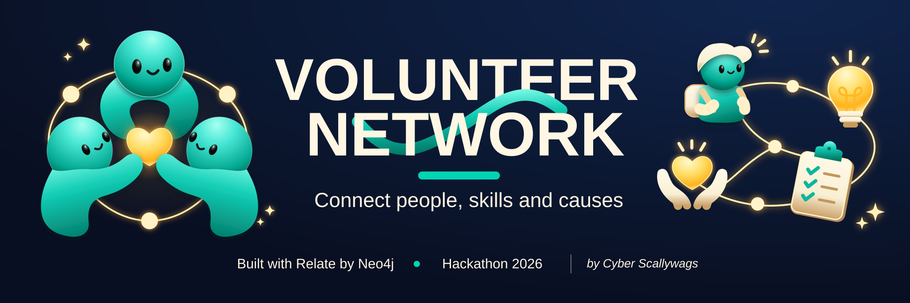
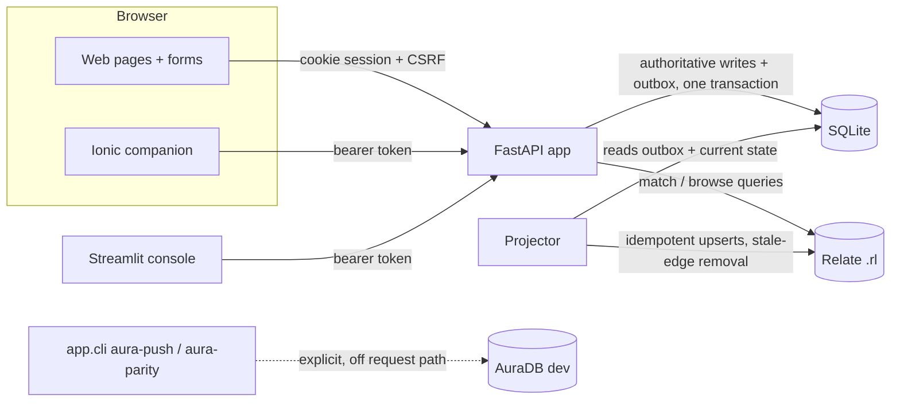

<p align="center">
  
</p>

# Volunteer Network

**One volunteer account for helping several organisations, with graph-backed explanations of why
people and projects fit.**

A volunteer keeps one skills profile and chooses which organisations can see them. They say which
skills they have, which they offer, and which they never want to be matched on, and they can prefer
or exclude causes. A moderator vets each new volunteer before they can be matched. Active
volunteers can suggest projects to an organisation, and that organisation's admins scope and
approve them before they go live. A [Relate](https://relatedb.ai/docs/) graph decides who matches
what (Relate is the embedded graph engine from Neo4j Labs). Each result says which skills matched, whether the volunteer prefers the cause, and what is
still needed. When a volunteer is eligible for a project, they become a candidate on the project
lead's ranked list. The lead invites who they want, and an invited volunteer joins the team by
saying yes.

> All people, projects and accounts in this repository are fictional. *DataKind UK*,
> *Cyber Scallywags* and *InterLinkRCT* are used as illustrative organisations only. Their use
> implies no endorsement or live partnership. The names can be changed with `ORG_NAMES`, which
> also removes their logos and photographs (see [`data/orgs/`](data/orgs/README.md)) from the
> `/showcase` page.

| Surface | Tech | Local URL |
|---|---|---|
| JSON API: every action in the system | FastAPI, bearer tokens, OpenAPI docs | http://localhost:8080/api/docs |
| Web app (volunteers, project leads, org admins) | FastAPI + Jinja2, server-rendered forms, responsive | http://localhost:8080 |
| Mobile companion (matches, opportunities, notifications, profile, suggestion status) | Ionic + Angular, JSON API only | http://localhost:8100 (Compose) |
| Admin console (screening, org management, users and roles, projection, graph) | Streamlit, JSON API only | http://localhost:8501 |
| Docs portal and reference manual | Zensical (portal) + Sphinx/Furo (manual at `/manual/`) | http://localhost:8200 |
| Mail sidecar (onboarding emails; catches everything, delivers nothing) | Mailpit, SMTP on `mail:1025` | http://localhost:8025 (Compose) |
| Matching graph | Relate 1.0.1, embedded single-file `.rl` store | `data/demo.rl` (bundled, read-only) |
| Transactional store | SQLite (WAL) | `var/dvn.sqlite3` (runtime, ignored) |

## Contents

- [Clean start with uv](#clean-start-with-uv)
- [Clean start with Docker Compose](#clean-start-with-docker-compose)
- [Demo accounts and walkthrough](#demo-accounts)
- [Roles and onboarding](#roles-and-onboarding)
- [The API](#the-api)
- [Assistants (Pydantic AI)](#assistants-pydantic-ai)
- [Audit, Logfire and evals](#audit-logfire-and-evals)
- [Inspect the bundled graph](#inspect-the-bundled-graph)
- [How are you using Relate, and why?](#how-are-you-using-relate-and-why)
- [Matching rules](#matching-rules)
- [Architecture](#architecture)
- [Tooling](#tooling)
- [Security and privacy](#security-and-privacy)
- [Optional AuraDB](#optional-auradb)
- [Tests](#tests)
- [Reuse, AI assistance and licences](#reuse-ai-assistance-and-licences)

## Clean start with uv

You need [uv](https://docs.astral.sh/uv/). uv installs Python 3.14 if it is missing. The Relate
engine comes from the locked `relate-db==1.0.1` wheel, so the
[Relate CLI](https://relatedb.ai/docs/get-started/install/) is needed only for the optional
`relate ...` inspection commands.

```sh
git clone <this repository> && cd <repository>
uv sync --locked                 # Python 3.14 env from uv.lock
uv run task reset                # disposable demo: var/dvn.sqlite3 + writable copy of data/demo.rl
uv run task web                  # http://localhost:8080
```

On its first start, `task web` seeds the demo itself if `var/` is empty, so `task reset` is
optional the first time. Run `task reset` again whenever you want the demo back to its starting
state. It deletes only `var/dvn.sqlite3` and `var/graph.rl`, and it refuses to run when
`APP_ENV=production`.

To run the admin console as well:

```sh
uv sync --locked --group admin
uv run task admin                # http://localhost:8501; sign in as Sam, Mo, Kofi or Rhiannon (addresses below)
```

To build and serve the docs (portal at `/`, manual at `/manual/`; pages in `docs/content`):

```sh
uv sync --locked --group docs
uv run task docs_serve           # http://localhost:8200 (task docs_live: live reload on :8201)
```

## Clean start with Docker Compose

```sh
docker compose up -d --build --wait     # or: uv run task up
# web http://localhost:8080 · mobile http://localhost:8100 · admin http://localhost:8501
# docs http://localhost:8200 · mail inbox http://localhost:8025
docker compose exec web python -m app.cli inspect
docker compose down -v                  # removes the demo volume
```

If those ports are already in use, run
`WEB_PORT=18080 ADMIN_PORT=18501 MOBILE_PORT=18100 DOCS_PORT=18200 MAIL_PORT=18025 docker compose up -d --build --wait`.
The web container copies the bundled `data/demo.rl` into the `dvn-data` volume on its first start
and seeds the demo accounts. The admin container shares that volume. The mobile image runs the
Ionic lint and unit tests while it builds. Its nginx then proxies `/api/` to the web app.

### External access with a Cloudflare Tunnel

The stack binds to `127.0.0.1` only. To reach it from outside, put the tunnel's token in `.env` as
`CLOUDFLARE_TUNNEL_TOKEN` (see `.env.example`) and start the opt-in `tunnel` profile:

```sh
docker compose --profile tunnel up -d --build --wait     # or: uv run task tunnel
docker compose logs tunnel                               # "Registered tunnel connection" when up
```

The `tunnel` service runs `cloudflared` on the Compose network, so the tunnel's public hostnames
(Cloudflare Zero Trust > Networks > Tunnels) point at service names: `http://web:8080`,
`http://mobile:8080`, `http://admin:8501` or `http://docs:8080`. The demo accounts share one
published password, so put anything you expose behind a Cloudflare Access policy.

## Demo accounts

Every demo account uses the password **`demo-password-1`**. These accounts exist only in the
disposable local demo. They are seeded by `reset` or by a first start with `APP_ENV=test`, and
never when `APP_ENV=production`.

| Email | Role | Volunteers with | Shows |
|---|---|---|---|
| `sam@cyberscallywags.uk` | **System admin** | — | access to everything: users and roles, every organisation, projection, graph |
| `mo@cyberscallywags.uk` | **Moderator** | — | the volunteer screening queue |
| `rhiannon@datakind.uk` | **Org admin**, DataKind UK | DataKind UK | the right reviewer for the pending suggestion; manages DataKind UK volunteers |
| `nicole@datakind.uk` | **Org admin**, DataKind UK | — | a second admin for the same organisation, who does not volunteer |
| `zoe@datakind.uk` | **Team coordinator**, DataKind UK | — | assigns project leads and decides who joins DataKind UK's teams; cannot review suggestions or remove volunteers |
| `ella@datakind.uk` | **Reviewer**, DataKind UK | — | reviews DataKind UK's suggestions and sees coverage; cannot invite candidates or assign a lead |
| `kofi@cyberscallywags.uk` | **Org admin**, Cyber Scallywags | Cyber Scallywags | admin and volunteer in the same organisation; no standing in DataKind UK |
| `nia@cyberscallywags.uk` | volunteer, **in screening** | Cyber Scallywags | not matchable until vetted; her first aid fills a gap once Mo approves her |
| `asha@cyberscallywags.uk` | volunteer; lead of Winter Outreach Kitchen | DataKind UK, Cyber Scallywags | one profile across two organisations; author of the pending suggestion |
| `bryn@cyberscallywags.uk` | volunteer | Cyber Scallywags, InterLinkRCT | already on the Winter Outreach team; author of a rejected suggestion; part-way through InterLinkRCT's own onboarding workflow (one step done, waiting for the welcome call to be confirmed) |
| `cerys@cyberscallywags.uk` | volunteer; lead of Food Bank Demand Dashboard | DataKind UK | no cause preference, so matched on skills alone; her project has a two-step team onboarding ready to switch on |
| `gwen@cyberscallywags.uk` | volunteer | Cyber Scallywags | a hard exclusion: offers cooking and driving but excludes *active listening* |
| `dev@cyberscallywags.uk`, `farah@cyberscallywags.uk` | volunteers | DataKind UK | preferred-cause ranking; Farah's first aid is outside Cyber Scallywags |

The fixture (`data/fixtures/demo.json`) contains three organisations (two with their own org
admins), one organisation with all three of its roles held by different people (DataKind UK: org
admins, a team coordinator and a reviewer), a system admin, a moderator, a volunteer in screening, a volunteer in both organisations, a formed
team, overlapping project skills, one hard exclusion (Gwen), one unfilled skill
(*First aid* for Winter Outreach Kitchen), one approved project per organisation, one suggestion
awaiting review (*Outreach Data Audit*), one unfinished draft suggestion (*Password Manager
Clinic*, visible to Asha only) and one rejected suggestion.

Walkthrough (also in [docs/content/project/demo-script.md](docs/content/project/demo-script.md)):

1. Sign in as **Asha** and switch between DataKind UK and Cyber Scallywags with the header
   switcher. Switching does not sign you in again, and it is a separate action from joining.
2. *My suggestions* shows **Outreach Data Audit** as *In review* and **Password Manager Clinic**
   as a *Draft*. Open the draft: it can be saved again, discarded, or completed and submitted
   for review. Nobody else sees it until then.
3. Sign in as **Kofi**. He is org admin for Cyber Scallywags, so the DataKind UK review queue
   gives him a 403 and the suggestion gives him a 404.
4. Sign in as **Rhiannon**, open the suggestion and choose *Approve and activate*. The approval
   records her name, the revision and the time. It is projected to Relate and appears under
   *Projects*. Its author is notified at each step.
5. As Rhiannon, open the project. Candidates are listed per required skill, and coverage is
   shown. **Zoe**, the team coordinator, sees the same candidates and *Assign the project lead*
   on that page, and gets a 403 on the review queue; **Ella**, the reviewer, sees the queue and
   the coverage but not the candidates.
6. As **Asha**, open *Profile* and set *Active listening* to **Exclude**. Asha disappears from
   Winter Outreach Kitchen and Outreach Data Audit, and her *My matches* page explains why. In
   Rhiannon's view, Outreach Data Audit now shows a coverage gap for *Active listening*. As Kofi,
   Cyber Scallywags' coverage shows gaps for *Active listening* and *Community cooking*, because
   Gwen, the other cook, also excludes active listening, as well as the existing *First aid* gap.
7. In the admin console, sign in as **Mo** and approve **Nia** from *Volunteer screening*. Nia is
   notified that she is active. Relate now finds her eligible for Winter Outreach Kitchen, so the
   *First aid* gap closes, and both Nia and the project lead, Asha, are notified. Nia says yes on
   *Opportunities* (web or mobile) and Asha accepts on the project page. Nia is now on the team,
   which is stored in Relate as `(:Volunteer)-[:ON_TEAM]->(:Project)`.

## Roles and onboarding

| Role | Scope | Can |
|---|---|---|
| System `admin` | everything | everything below, in every organisation; grant and revoke all roles; create organisations; projection replay; graph overview; see emails |
| System `moderator` | all volunteers | the screening queue: approve, request more information, decline, suspend, reinstate (never their own account) |
| `org_admin` | one organisation | review its project suggestions; withdraw projects and assign project leads; list and remove its volunteers; everything a project lead can do, for any of its projects; edit its onboarding workflow (steps and email templates) and confirm volunteers' steps |
| `reviewer` | one organisation | review its project suggestions |
| `team_coordinator` | one organisation | assign project leads; everything a project lead can do, for any of its projects (invite, accept, suspend, remove); list its volunteers. No reviewing, and no removing volunteers from the organisation |
| Project lead | one project (the author by default; team coordinators and org admins assign it) | invite or pass over candidates; run the project's own team onboarding and confirm its steps; accept volunteers onto the team; suspend, reinstate or remove team members |
| Volunteer | themselves | profile, joining organisations, submitting for vetting, answering offers, leaving teams, suggesting projects once active (as a private draft first, if they wish) |

Roles come only from the seed, a system admin (API or console) or `python -m app.cli
grant-reviewer`. Signup never grants a role. Every check happens on the server, against the
organisation or project named in the request.

**Volunteer onboarding.** A volunteer fills in the profile form, then *Submit for vetting* moves
them from `draft` to `screening`, and moderators are notified. A moderator then sets one of:
`active`, `info_requested` (the volunteer adds detail and resubmits), `declined`, or later
`suspended` (which can be reinstated). Only `active` volunteers get `VOLUNTEERS_WITH` edges in
Relate, so the graph itself makes sure no one is matched before they have been vetted.

Once a volunteer is active, the projector asks Relate after each graph update which volunteers
match which active projects (the same matching query as everywhere else). Each new pair is a
candidate, shown to the project lead in ranked order: preferred cause, then required skills
covered, then optional skills. The volunteer is not told yet. The lead (or a team coordinator or org admin of the
organisation, whose answer counts the same) invites the candidates they want, and each invited volunteer is notified.
When the volunteer says yes they are on the team, and Relate records an `ON_TEAM` edge (or, if
the project has its own team onboarding switched on, they start its steps first: see below). A no from
either side declines the pair, and the lead side can reopen it later. A candidate who stops
matching lapses, and comes back if they match again.

A few rules keep this honest. The project lead is on their own team automatically; nobody else
decides on their own place. A volunteer who is suspended, or who leaves or is removed from the
organisation, comes off its teams and loses any open invitation; a lead in that position loses
the lead's powers and the organisation's team coordinators and org admins are told. An
invitation left unanswered gets one reminder
(`INVITATION_REMINDER_DAYS`, default 7) and then closes (`INVITATION_EXPIRY_DAYS`, default 14),
returning the volunteer to the candidate list. Every change is kept in `placement_events` with who
made it. The coverage page counts a required skill as covered only once someone who offers it is
on the team.

**Each organisation's own onboarding.** Vetting is done once, for the whole network. On top of
it, every organisation has its own workflow for the volunteers who join it: ordered steps, each
ticked off either by the volunteer or by one of the organisation's admins, and each optionally
announced by an email. Org admins edit all of it in the admin console's *Onboarding* section:
the steps and their order, the email templates, and the switch that turns the workflow on. The
same section shows where each volunteer is and which emails went out. A new organisation starts
with a two-step starter workflow, switched off.

- Switching a workflow on applies to volunteers who join from then on. Current members are not
  enrolled. Leaving, or being removed, cancels an unfinished run; joining again starts a new one.
- A volunteer sees their steps on the web app's *Onboarding* page (and at `GET /me/onboarding`)
  and is notified in-app at each one. Steps are taken in order.
- A template is plain text with placeholders from a fixed list (`{{ volunteer_name }}`,
  `{{ organisation_name }}`, `{{ project_title }}`, `{{ step_title }}`, `{{ step_description }}`,
  `{{ steps_done }}`,
  `{{ steps_total }}`, `{{ onboarding_url }}`). Anything else in curly brackets is refused when
  the template is saved, so a template cannot reach other data. *Preview* fills it with sample
  values and *Send a test to me* queues it to the admin's own address.
- Emails are written to an outbox in SQLite in the same transaction as the step they announce,
  and the web app sends them over SMTP (`SMTP_HOST`, `SMTP_PORT`, `SMTP_USERNAME`,
  `SMTP_PASSWORD`, `SMTP_STARTTLS`, `EMAIL_FROM`, `PUBLIC_URL`), retrying a failure five times
  with a growing delay. In the Compose stack the SMTP server is the `mail` sidecar
  ([Mailpit](https://mailpit.axllent.org/)), which catches every message and delivers none: read
  them at http://localhost:8025. Any SMTP relay can take its place. With no `SMTP_HOST`
  (`uv run task web`) nothing is sent and the console shows the messages as not sent.
- Org admins see recipients by name. Addresses are read only when a message is sent.
- The workflow is held in Relate as well as SQLite: each step is an `(:OnboardingStep)` node
  owned by its organisation and chained with `NEXT_STEP`, `onboarding_enabled` on the
  organisation says whether it is switched on, and a volunteer's place is an `AT_STEP` edge plus
  one `COMPLETED_STEP` edge per finished step. It is projected through the same outbox as
  everything else, with the request that made the change. Email templates and addresses stay in
  SQLite.
- The onboarding assistant follows the workflow from the graph. It tells a volunteer what an
  organisation asks of new joiners, which step they have reached and who completes it, and it
  can tick off a step that is theirs, after approval. It cannot skip ahead or confirm a step
  that belongs to the organisation: the tool checks the graph and the service checks again.
- In the demo, InterLinkRCT's workflow is switched on and Bryn is part-way through it; the
  other two organisations' are switched off.
- The workflow does not decide who is matched: the matching query is unchanged.

**Each project's own team onboarding.** A project can have the same kind of workflow for the
volunteers joining its team: ordered steps, each ticked off by the volunteer or confirmed by
the lead side, each optionally announced by an email. With it switched on, an invited volunteer
who says yes starts the steps instead of joining at once. When the steps are done the lead side
*accepts* them onto the team, and only then does Relate record `ON_TEAM`. With it switched off
(every project starts that way) saying yes still joins the team directly.

The lead side is the project's lead and the organisation's team coordinators and org admins, and
nobody else. Team coordinators and org admins assign the lead: on the project's page (*Assign
the project lead*) or with `PUT /orgs/{org}/projects/{id}/lead`; org admins can also do it in the
admin console's *Organisations* section, which team coordinators do not see. The lead side can:

- edit the project's steps and switch them on, on the project's page (*Team onboarding*); org
  admins can also do it in the admin console (*Onboarding* → *Volunteers joining a project's
  team*);
- confirm a volunteer's step, and **accept** them once no step is left;
- **suspend** a team member, with a reason the volunteer is shown: they are off the team, and
  out of `ON_TEAM`, until **reinstated**;
- **remove** someone who is on the team, still onboarding or suspended.

The organisation's rules hold throughout:

- A project's workflow uses the organisation's email templates. Only org admins write them, and
  another organisation's template is refused.
- The organisation's own onboarding comes first. A volunteer who is still part-way through it
  cannot say yes to an invitation (the invitation stays open), and cannot be accepted or
  reinstated.
- Only an active volunteer of the organisation is accepted or reinstated. Leaving the
  organisation, being removed from it or being suspended from the network ends a place on a
  team in any of these states, and the project's onboarding with it.
- A lead who loses their standing loses these powers, a lead cannot hand the project on, and
  nobody accepts or suspends themselves. The lead is not suspended from their own team: a team
  coordinator or org admin assigns a new lead first.
- A project's steps are held in Relate like the organisation's:
  `(:Project)-[:HAS_TEAM_STEP]->(:OnboardingStep)`, `onboarding_enabled` on the project, and the
  same `NEXT_STEP`, `AT_STEP` and `COMPLETED_STEP` edges. The onboarding assistant reads them
  there and treats them the same way: it can tick off the volunteer's own current step after
  approval, and it has no tool to accept anyone onto a team.
- In the demo, Food Bank Demand Dashboard has two steps ready, switched off. Sign in as Cerys,
  switch them on under *Team onboarding*, invite Dev, and follow it through as Dev.

**Project onboarding:** *In review* → (*Scoping: more detail requested* → revised) →
*Approved (activating…)* → *Active* (visible and matching once projected to Relate), with
*Rejected* and *Withdrawn* as end states.

Every transition sends an in-app notification to the person it affects: the volunteer for vetting
and placement steps, the author for project steps, and the lead and admins for new candidates and
suggestions. The web app and the mobile app have *Notifications* and *Opportunities* pages, and
the Profile page shows the onboarding status on both.

## The API

**Every action in the system is an endpoint under `/api/v1`.** Interactive docs are at
`/api/docs`. The mobile app and the Streamlit admin console use nothing else: neither touches
SQLite or Relate directly. The server-rendered web pages call the same service functions
in-process, so roles, states and version checks are enforced in one place
(`src/app/services/`, `src/app/placements.py`).

| Group | Endpoints |
|---|---|
| auth | `POST /auth/signup`, `POST /session`, `DELETE /session` |
| me | `GET /me`, `PUT /me/active-org`, `GET/PUT /profile`, `POST /me/vetting`, `GET /notifications`, `POST /notifications/{id}/read`, `POST /notifications/read-all` |
| organisations | `GET /orgs`, `PUT/DELETE /orgs/{org}/membership`, `GET /orgs/{org}/matches`, `GET /orgs/{org}/projects`, `GET /orgs/{org}/coverage`, `GET /orgs/{org}/volunteers`, `POST /orgs/{org}/volunteers/{user}/remove` |
| projects | `GET/POST /submissions`, `POST /submissions/drafts`, `PUT /submissions/{id}/draft`, `POST /submissions/{id}/submit`, `GET/DELETE /submissions/{id}`, `POST /submissions/{id}/revisions`, `GET /orgs/{org}/submissions`, `POST /orgs/{org}/submissions/{id}/decision`, `POST /orgs/{org}/projects/{id}/withdraw`, `PUT /orgs/{org}/projects/{id}/lead` |
| placements | `GET /placements`, `POST /placements/{project}/answer`, `POST /placements/{project}/leave`, `GET /projects/{project}/placements`, `POST /projects/{project}/placements/{volunteer}/answer`, `POST /projects/{project}/placements/{volunteer}/accept`, `POST /projects/{project}/placements/{volunteer}/suspend`, `POST /projects/{project}/placements/{volunteer}/reinstate`, `POST /projects/{project}/placements/{volunteer}/remove` |
| moderation | `GET /moderation/volunteers?status=`, `GET /moderation/volunteers/{user}`, `POST /moderation/volunteers/{user}/decision` |
| admin | `GET /admin/users`, `PUT/DELETE /admin/users/{user}/system-roles/{role}`, `PUT/DELETE /admin/orgs/{org}/roles/{user}/{role}`, `POST /admin/orgs`, `GET /admin/projection`, `POST /admin/projection/replay`, `GET /admin/graph`, `GET /admin/graph/view` |
| onboarding | `GET /me/onboarding`, `POST /orgs/{org}/onboarding/steps/{step}/complete`, `GET/PUT /orgs/{org}/onboarding`, `POST /orgs/{org}/onboarding/steps`, `PUT/DELETE /orgs/{org}/onboarding/steps/{step}`, `POST /orgs/{org}/onboarding/steps/{step}/move`, `POST /orgs/{org}/onboarding/templates`, `PUT/DELETE /orgs/{org}/onboarding/templates/{template}`, `POST /orgs/{org}/onboarding/templates/preview`, `POST /orgs/{org}/onboarding/templates/{template}/test`, `GET /orgs/{org}/onboarding/volunteers`, `POST /orgs/{org}/onboarding/volunteers/{user}/steps/{step}/complete`, `GET /orgs/{org}/onboarding/emails`; and for a project's team onboarding, under `/orgs/{org}/projects/{project}/onboarding`: `GET/PUT` on it, `POST /steps`, `PUT/DELETE /steps/{step}`, `POST /steps/{step}/move`, `POST /steps/{step}/complete`, `GET /volunteers`, `POST /volunteers/{user}/steps/{step}/complete` |
| assistants | `GET /agents`, `POST /agents/volunteer-onboarding`, `POST /agents/project-scoping`, `POST /agents/project-review`, `POST /agents/match-shortlist`, `POST /agents/match-explainer`, `POST /agents/audit`, `POST /agents/runs/{run}/approval`, `GET /agents/runs`, `GET /agents/runs/{run}` |
| audit | `GET /admin/audit/events`, `GET /admin/audit/rbac`, `GET /admin/audit/usage`, `GET /admin/audit/checks` |

```sh
TOKEN=$(curl -s -X POST localhost:8080/api/v1/session -H 'content-type: application/json' \
  -d '{"email":"mo@cyberscallywags.uk","password":"demo-password-1"}' | python3 -c 'import sys,json;print(json.load(sys.stdin)["token"])')
curl -s localhost:8080/api/v1/moderation/volunteers -H "Authorization: Bearer $TOKEN"
```

Errors are JSON: 401 signed out, 403 role missing, 404 unknown or not visible to you, 409 stale
`version` or wrong state, 422 invalid input. The assistants add 429 (daily quota used), 502 (the
model failed or a limit stopped the run) and 503 (no model configured).

## Assistants (Pydantic AI)

Six [Pydantic AI](https://ai.pydantic.dev/) agents sit on top of the same services as the pages
and the API (`src/app/agents/`). They are **off until `AGENT_MODEL` is set** (for example
`AGENT_MODEL=anthropic:claude-sonnet-5-5` with `ANTHROPIC_API_KEY`); without it their endpoints
answer 503 and nothing else changes. The Relate graph still decides every match: the assistants
explain and advise, and never decide who is eligible.

| Assistant | Who can run it | What it does | Can it change anything? |
|---|---|---|---|
| `volunteer-onboarding` | any signed-in volunteer, own profile only | maps "what I can do" to catalogue skills and causes, with a reason for each | saves the profile; submits for vetting; ticks off the volunteer's current step in an organisation's onboarding workflow, or in a project's team onboarding, both of which it reads from the Relate graph. Each waits for approval. It cannot accept anyone onto a team |
| `project-scoping` | active volunteers, for an organisation they belong to | drafts title, summary, cause and skills; flags overlap with active projects | saves a private draft, after approval. Never submits for review |
| `project-review` | the organisation's reviewers and admins, on a suggestion awaiting review | checks clarity, fit, skills and overlap; recommends a decision with a reason for the author | no. The reviewer decides |
| `match-shortlist` | the project's lead, or an admin of its organisation | recommends which of the graph's candidates to invite to cover the uncovered skills; names any gap left | sends an invitation, after approval |
| `match-explainer` | a volunteer, for an organisation they volunteer with | explains why each project matches and what their own exclusions rule out | no |
| `audit` | system admins | explains the automatic access and usage checks in order of severity | no |

What holds for all of them, in code rather than in a prompt:

- **Who is acting comes from the session.** No tool takes a user ID for "me", so a prompt cannot
  point an assistant at someone else's data.
- **Every tool calls the same service function as the API**, with the caller's ID, so each role
  check runs again inside the tool. A run is also authorised before a model is asked anything.
- **Writes wait for approval.** A tool that changes something validates its arguments, then
  stops the run (`ApprovalRequired`). The API answers `awaiting_approval` with exactly what
  would be done; `POST /agents/runs/{run}/approval` continues or refuses it. Only whoever
  started a run can answer it, once.
- **Outputs are checked against the data** by output validators: every skill, cause, person and
  project must be one the application returned; an exclusion cannot be changed; a shortlist's
  remaining gaps and the audit's overall verdict are computed, not taken from the model.
- **Runs are limited**: requests, tool calls, tokens and wall-clock time per run, and runs per
  account per day (`AGENT_*` in `.env.example`).
- **The audit assistant is a pipeline** (`pydantic_graph`): three plain-code steps gather the
  roles, the usage figures and the checks; only the last step asks the model.

```sh
TOKEN=...   # asha@cyberscallywags.uk, as above
curl -s -X POST localhost:8080/api/v1/agents/volunteer-onboarding \
  -H "Authorization: Bearer $TOKEN" -H 'content-type: application/json' \
  -d '{"message":"I do bookkeeping for a small charity and would like to help with fundraising."}'
# -> {"status":"awaiting_approval","pending":[{"tool":"save_profile","summary":"Save to your profile: ..."}]}
curl -s -X POST localhost:8080/api/v1/agents/runs/$RUN/approval \
  -H "Authorization: Bearer $TOKEN" -H 'content-type: application/json' -d '{"approve":true}'
```

The assistants are available over the JSON API and, for the audit assistant, in the admin
console. The server-rendered pages and the mobile app do not call them yet.

## Audit, Logfire and evals

**Audit trail** (`src/app/audit.py`, table `audit_log`). Role grants and removals are written in
the transaction that makes them. Every request that changes something, and every request that is
refused, is recorded with the acting account, the route as declared (never the IDs or anything
typed) and the outcome. Sign-ins and assistant runs, approvals and refused tool calls are
recorded too. System admins read it in the console's **Audit** section or under `/admin/audit/*`:
the trail, who holds which role, usage by action and by assistant (runs, failures, tokens), and
the **checks**: a suspended account that still holds a role, an organisation with no admin, a
single system admin, repeated refusals, bursts of failed sign-ins, self-granted roles.
`uv run python -m app.cli audit` prints the checks and exits 1 if any is high.

**Logfire** (`src/app/observability.py`). Set `LOGFIRE_TOKEN` and each request is one trace:
the HTTP span, the assistant run, each model request and tool call with token counts, and the
placement sweep. Counters cover audit events and assistant runs. Each run's row keeps its trace
ID. With no token everything still runs and is sent nowhere. Request headers, bodies and
endpoint arguments are not recorded, and prompts and model output are left off the spans when
`APP_ENV=production` unless `LOGFIRE_INCLUDE_CONTENT=true`.

**Evals** (`src/app/agents/evaluators.py`, `evals.py`).

- *Online*: two deterministic evaluators run in the background on every live run and send their
  result to Logfire on the run's own trace: `NoContactDetails` (no email or phone number in an
  output) and `ReasonsGiven` (every suggestion says why).
- *Offline*: `uv run python -m app.cli evals [--agent NAME] [--judge]` runs each assistant's
  dataset against a disposable copy of the demo with the configured model, scores it
  (expected skills, recommendation, approval behaviour, request and tool-call limits; `--judge`
  adds an LLM judge for tone), and exits 1 if an assertion fails. With `LOGFIRE_TOKEN` set each
  dataset is an experiment in Logfire.

## Inspect the bundled graph

`data/demo.rl` is a real single-file Relate store, committed read-only and rebuilt from
`data/fixtures` by `uv run task bundle`. A test fails if the committed file drifts from what the
fixtures rebuild to.

```sh
uv run task inspect                     # = python -m app.cli inspect --store data/demo.rl
```

Expected output (volunteer IDs are opaque in the graph; the CLI labels known demo IDs):

```text
organisation     | project                         | cause             | skill                         | eligible_volunteers
-----------------+---------------------------------+-------------------+-------------------------------+-----------------------------------------------------
Cyber Scallywags | Winter Outreach Kitchen         | Homelessness      | Active listening              | Asha (u_8d06f6350514542f)
Cyber Scallywags | Winter Outreach Kitchen         | Homelessness      | Community cooking             | Asha (u_8d06f6350514542f)
Cyber Scallywags | Winter Outreach Kitchen         | Homelessness      | First aid                     | — coverage gap —
Cyber Scallywags | Winter Outreach Kitchen         | Homelessness      | Van driving                   | Bryn (u_b2fc33a819a557b1)
DataKind UK      | Food Bank Demand Dashboard      | Food Security     | Bookkeeping                   | Cerys (u_8e53893c6dce5e79), Dev (u_9d1d1a6fd5d559ae)
DataKind UK      | Food Bank Demand Dashboard      | Food Security     | Spreadsheet and data analysis | Asha (u_8d06f6350514542f), Dev (u_9d1d1a6fd5d559ae)
InterLinkRCT     | Community Garden Raised Beds    | Environment       | Carpentry                     | Bryn (u_b2fc33a819a557b1)
InterLinkRCT     | Community Garden Raised Beds    | Environment       | Gardening                     | — coverage gap —
InterLinkRCT     | Community Group Digital Drop-in | Digital Inclusion | Cyber security awareness      | — coverage gap —
InterLinkRCT     | Community Group Digital Drop-in | Digital Inclusion | Web development               | — coverage gap —
```

With the Relate CLI (v1.0.1) installed, you can query the same file directly:

```sh
relate --database data/demo.rl --read-only --mode table \
  "MATCH (o:Organisation)-[:OWNS_PROJECT]->(p:Project)-[:REQUIRES_SKILL]->(s:Skill)
   RETURN o.name AS organisation, p.title AS project, collect(s.name) AS required ORDER BY organisation"
relate --database data/demo.rl --read-only --mode table \
  "MATCH (n) RETURN labels(n)[0] AS label, count(n) AS nodes ORDER BY label"
```

The bundled store has 80 nodes (5 causes in 3 themes, 15 skills in 16 skill areas, 3 organisations,
4 active and 2 completed projects, 10 engagements, 8 onboarding steps and 14 volunteer IDs, of which Sam, Mo, Nicole, Zoe and Ella have
no edges and Nia, still in screening, has no membership edge) and 176 relationships, including
five `ON_TEAM`. `uv run python -m app.cli matches --org datakind-uk --store data/demo.rl`
prints the ranked candidates for one organisation: Dev, Asha, then Cerys.

The app's writable store is `var/graph.rl` (or `/data/graph.rl` in Compose). The app opens the
store per unit of work, so `relate --database var/graph.rl --read-only ...` also works while the
server is running.

## How are you using Relate, and why?

This section is the summary. The full account is in
[docs/content/project/relate.md](docs/content/project/relate.md): the store files, the adapter,
how each change is projected into the graph, a table of every query with the screens and
endpoints it serves, the matching query explained line by line, and how to inspect the graph.

Relate is an embedded graph database queried in Cypher, published by Neo4j Labs as an
experimental project (not a supported Neo4j product). It runs inside the application's process
through the `relate-db` Python package, and the graph is one `.rl` file.

**What Relate does here.** Relate is the matching engine and the main demo graph. It stores
organisations, opaque volunteer IDs, the shared skill and cause catalogue, each volunteer's skill
offers, exclusions and cause preferences, approved projects and their requirements. One Cypher
query (`MATCH_CANDIDATES` in [src/app/graph/cypher.py](src/app/graph/cypher.py)) decides every
match by following relationships:

```text
(:Organisation)-[:OWNS_PROJECT]->(:Project)-[:SERVES_CAUSE]->(:Cause)
(:Project)-[:REQUIRES_SKILL]->(:Skill)        (:Project)-[:BENEFITS_FROM_SKILL]->(:Skill)
(:Volunteer)-[:VOLUNTEERS_WITH]->(:Organisation)          only while opted in AND vetted (active)
(:Volunteer)-[:ON_TEAM]->(:Project)                       on the team: accepted, and not suspended
(:Volunteer)-[:HAS_SKILL|OFFERS_SKILL|EXCLUDES_SKILL]->(:Skill)
(:Volunteer)-[:PREFERS_CAUSE|EXCLUDES_CAUSE]->(:Cause)
(:Organisation)-[:HAS_ONBOARDING_STEP]->(:OnboardingStep)-[:NEXT_STEP]->(:OnboardingStep)
(:Project)-[:HAS_TEAM_STEP]->(:OnboardingStep)-[:NEXT_STEP]->(:OnboardingStep)
(:Volunteer)-[:AT_STEP|COMPLETED_STEP]->(:OnboardingStep)  their place in a workflow
```

The same query returns the explanation fields: matched required skills, matched optional skills,
remaining requirements and the preferred-cause flag. Separate queries return coverage gaps, the
volunteer's own exclusion reasons, browse results and the inspection view.

**Why a graph, and why Relate.**

- The question has the shape of a path. *Is there a path from this organisation through an
  approved project to a skill the volunteer has and offers, with no exclusion edge back to the
  project's cause or required skills?* That is a short `MATCH` with `NOT EXISTS {}`. It is not a
  set of join tables plus application code that has to agree with them.
- Explanations come with the result. The fields that justify a match come from the same
  traversal that made it, so the result and its explanation cannot disagree.
- Relate is embedded and stored in a single file. The whole graph is one `.rl` file. Judges can
  clone it, inspect it with the `relate` CLI and run the app on a writable copy. No database
  server or cloud account is needed. The Python binding (`relate-db`, PEP 249) runs in-process on
  CPython 3.14.
- The Cypher is portable. The statements use the Neo4j 5 dialect, so the optional AuraDB parity
  check runs the same query text on a cloud instance.

**Engine choice and verification.** The embedded binding `relate-db==1.0.1` (abi3 wheels for
macOS, Linux and Windows) was installed and checked on CPython 3.14.5. A write, close and reopen
check passed, and the 1.0.1 CLI read the file the binding wrote. The binding is used instead of
the earlier PoC's subprocess CLI adapter. The pin matches the tested CLI version.

**Engineering details.**

- **Single writer.** Relate locks the store exclusively for every opener, read-only openers
  included. The adapter therefore opens the store per unit of work (well under a millisecond on
  the demo graph)
  and serialises access inside the process. If another process holds the lock, it retries a
  bounded number of times and then reports `GraphBusy`. Examples of such processes are the CLI
  or `relate --read-only`. The admin console goes through the API, so it never opens the store.
- **Safe queries.** Every value is a bound parameter. Reads are capped and raise an error rather
  than silently truncating results.
- **Relate decides, SQLite checks.** Relate makes the matching decision. SQLite is consulted only
  for access (membership and role in the target organisation), for freshness (results are
  withheld while a relevant projection is pending, and rows for projects no longer published in
  SQL are dropped) and for display names. Display names are shown only for volunteers who are
  currently opted in.

## Matching rules

Matching follows one interpretation, and the UI, these docs and
[tests/test_matching.py](tests/test_matching.py) all use it:

| Condition | Result |
|---|---|
| Volunteer opted in to the project's organisation, and the project is verified and published | The project is considered for matching |
| Project serves a cause the volunteer excluded, or requires a skill the volunteer excluded | The volunteer–project pair is excluded, even when another skill matches |
| Volunteer has **and** offers at least one required skill | They are a candidate for each eligible skill |
| Volunteer prefers the project's cause | Ranked ahead of otherwise comparable eligible matches |
| Volunteer has no cause preference | Skills-based matches are allowed for every cause they have not excluded |
| Volunteer excludes an optional skill | That skill is left out of explanations and scoring, and the pair is not excluded |
| A required skill has no eligible volunteer in that organisation | A coverage gap is shown |

Ranking is deterministic: preferred cause first, then the number of required skills covered, then
the number of optional skills offered, then stable IDs. A partial match is presented as a
contribution opportunity, with the skills still needed from others. Volunteers can turn on a
*Preferred causes only* filter. Exclusion explanations are visible only to the volunteer
concerned. Reviewers see eligible candidates and gaps.

## Architecture

The full write-up, with tools, components, data model, RBAC, workflows and decisions, is in
[docs/content/project/solution-architecture.md](docs/content/project/solution-architecture.md). The
[PDF](docs/content/project/solution-architecture.pdf) is an earlier snapshot of that page and
does not include later changes.



- **SQLite** holds identities, sessions, organisation memberships and roles, authoritative
  profile edits, submissions and their revisions, review history and the outbox.
- **Outbox projection** ([src/app/graph/projector.py](src/app/graph/projector.py)). Each
  state-changing request writes its change and an outbox row in the same SQLite transaction. The
  projector rebuilds that entity's graph state from the current SQLite rows inside one Relate
  transaction, then marks the row done. Failures stay queued with the error and an exponential
  backoff (capped at 60 s), and items with three or more failed attempts are flagged as failing.
  The projector runs straight after each change, in a background loop, at startup (replay after a
  restart), from `python -m app.cli drain` and from the console's *Replay outbox now* button.
  Because it reconciles to the current state, replaying an item is idempotent and the order
  items are processed in does not matter.
- **Publication** follows the states *Submitted* → *Changes requested* / *Rejected* /
  *Approved* → *Published* → *Withdrawn*. *Approved* becomes *Published* only once the approved
  revision is in Relate. Every transition checks the current state, revision and a version
  counter, so a stale or replayed form cannot publish twice.

Code map:

| Path | Purpose |
|---|---|
| `src/app/web/api.py` | the JSON API: every action, under `/api/v1` |
| `src/app/web/main.py`, `web/pages/`, `templates/` | the app factory and the server-rendered pages |
| `src/app/web/schemas.py` | the API contract: every request body and response model |
| `src/app/services/` | domain operations with server-side authorisation: access, roles, vetting, organisations, profiles, submissions |
| `src/app/placements.py` | candidate sweep from Relate matches, invitations, teams, reminders and expiry |
| `src/app/notify.py` | in-app notifications, written in the same transaction as the change |
| `src/app/profile_view.py` | the Profile screen (sections, skill types, labels, active and past projects), shared by the web page and the mobile API |
| `src/app/matching.py` | access and freshness checks around Relate queries |
| `src/app/graph/` | Relate adapter, Cypher, projector and AuraDB |
| `src/app/auth.py` | Argon2id hashing and opaque sessions |
| `src/app/sqlstore.py` | SQLite schema |
| `src/app/runtime.py` | wiring and the demo seed |
| `src/app/cli.py` | operator commands |
| `src/app/admin/main.py` | Streamlit admin console (an API client) |
| `mobile/` | Ionic app |

## Tooling

[docs/content/project/tooling.md](docs/content/project/tooling.md) lists every tool with its
version, configuration file and commands. In short:

| Area | Tools |
|---|---|
| Graph and data | Relate 1.0.1 (`relate-db`, embedded) and the optional Relate CLI; SQLite; optionally the Neo4j Python driver and AuraDB |
| Backend | Python 3.14, FastAPI, Pydantic, Uvicorn, Jinja2, argon2-cffi; Streamlit for the admin console |
| Mobile | Angular 22, Ionic 9, Capacitor 8, TypeScript, Vitest, ESLint; nginx in the container |
| Quality | pytest with coverage, Ruff, pre-commit (file hygiene, lock file, workflow syntax, branch names, commit prefixes) |
| Packaging | uv with `uv.lock`, taskipy (`uv run task ...`), Hatchling |
| Containers | Docker and Docker Compose: `web`, `admin`, `mobile` and `docs` images |
| Docs | Zensical (portal) and Sphinx with Furo (manual), from the same Markdown, warnings as errors |
| Automation | GitHub Actions (CI and CodeQL), Dependabot |

`uv run task --list` prints the tasks: `web`, `admin`, `reset`, `bundle`, `inspect`, `lint`,
`format`, `hooks`, `changelog`, `changelog_preview`, `test`, `up`, `tunnel`, `down`, `docs`, `docs_serve`, `docs_live` and
`docs_live_manual`.

## Security and privacy

- Passwords are hashed with Argon2id (`argon2-cffi`). Emails are normalised and unique. Sign-in
  takes the same time whether or not the email exists.
- Sessions use opaque, random, revocable tokens. Only their SHA-256 is stored. Cookies are
  `HttpOnly` and `SameSite=Lax`, and `Secure` over HTTPS (or when `COOKIE_SECURE=true` is set).
  Sign-in rotates the session.
- Every state-changing form carries a CSRF token: per session once signed in, and a
  double-submit cookie for sign-in and sign-up. The mobile API accepts only bearer tokens and
  never reads cookies.
- Roles (system admin, moderator, org admin, reviewer, team coordinator) are granted only by the
  seed, a system admin or, for the reviewer role, `python -m app.cli grant-reviewer`. Signup ignores any posted role. New accounts start
  in `draft`; only vetted (`active`) volunteers can be matched or suggest projects. Every protected request checks access against the organisation named
  in the URL or form. Unknown or invisible records return 404, and missing roles return 403.
- Reviewers cannot decide on their own suggestions.
- The graph contains no emails, passwords, sessions or private review notes. Volunteers appear
  in it only as opaque IDs. Candidate lists show display names and matching evidence, never
  contact details. Private review notes are shown only to that organisation's reviewers.
- Responses carry a CSP without inline scripts, `X-Frame-Options: DENY`, `nosniff` and
  `no-store` on dynamic pages.
- `APP_ENV=production` disables demo seeding and refuses to start on a database that holds demo
  (`@cyberscallywags.uk`) accounts.
- The assistants act only as the signed-in user, through the same service functions, and every
  change they propose waits for that user's approval (see
  [Assistants](#assistants-pydantic-ai)). Their tools return display names, never contact
  details. What a volunteer types to an assistant is sent to the configured model provider.
- The audit trail records actions, not content: no email address, password or form text.

## Optional AuraDB

Local signup, approval and matching never need Aura credentials. AuraDB is an explicit, opt-in
destination for the synthetic graph plus a match-parity check. It uses the Neo4j Python driver and
never runs on the request path. Use a designated **dev** instance:

```sh
cp .env.example .env            # fill AURA_URI=neo4j+s://..., AURA_PASSWORD=...
uv sync --locked --group aura
uv run --env-file .env python -m app.cli aura-push     # nodes get dvn_scope="dvn-demo-v1"
uv run --env-file .env python -m app.cli aura-parity   # same MATCH_CANDIDATES text on both engines
uv run --env-file .env pytest -m aura --no-cov
```

`aura-push` deletes only nodes whose `dvn_scope` is `dvn-demo-v1`, then copies every node and
relationship from the writable Relate store. `aura-parity` compares normalised result rows for
each organisation and exits with a non-zero status on any difference. **Status: not yet run.** No
dev instance or credentials were available while this was built. See
[docs/content/project/verification.md](docs/content/project/verification.md).

## Tests

```sh
uv run task test                # pytest: temporary SQLite + real Relate stores per test
uv run task lint
uv run task hooks               # every pre-commit hook on every file
docker build -f docker/mobile.Dockerfile --target test .     # Ionic lint + unit tests
COMPOSE_WEB_URL=http://localhost:8080 COMPOSE_MOBILE_URL=http://localhost:8100 \
  COMPOSE_ADMIN_URL=http://localhost:8501 uv run pytest -m compose --no-cov
```

The suite covers:

- one login across organisations, and switching versus joining
- role and tenant isolation, including forged organisation, submission and project IDs
- drafts (private to the author, partial content, edit in place, submit, discard), submission
  visibility, changes requested and revision, rejection, approval and withdrawal
- stale, repeated and self-approval attempts
- every row of the matching-rules table, the preferred-only filter, and profile edits propagating
  to Relate
- projection failure, withheld results, restart and replay, idempotent replay and persistence
  across restarts
- the bundled store matching a fresh build, and CLI access to it
- the mobile API, CSRF, cookie flags and the production guards
- RBAC across system admin, moderator, org admin, reviewer, team coordinator and project lead,
  including cross-organisation denials, and what a team coordinator can and cannot do
- volunteer onboarding end to end (draft → screening → active → eligible → both yes → team, with
  `ON_TEAM` in Relate), info requests, suspension, lapsed and revived offers, and removals
- project onboarding notifications at each phase, JSON errors, and OpenAPI coverage of every tag
- the API contract: every route answers in the shape it declares, and the mobile app's types
  match the OpenAPI document
- the graph schema against the bundled store, the AuraDB push and parity check against a
  stand-in driver, and the placement sweep beyond the row bound
- the admin console for each role, and the operator CLI
- each assistant with scripted stand-in models (no test reaches a real model): what it may read,
  what waits for approval, what each output validator sends back, refusal before any model is
  asked, run limits, the daily quota, and that only whoever started a run can answer it
- the audit trail: role changes, changed and refused requests, sign-ins, the checks, retention,
  and that no email reaches it
- Logfire, captured in memory: one trace from request to tool call, the online evaluators'
  results, the counters, and that request arguments stay off the spans
- the evaluators and the offline suites: a well-behaved stand-in passes each suite, a
  misbehaving one is caught by name, and the suites change nothing in the demo

Latest results are in [docs/content/project/verification.md](docs/content/project/verification.md).

## Reuse, AI assistance and licences

See [docs/content/project/reuse-and-attribution.md](docs/content/project/reuse-and-attribution.md) for what came from the earlier
template and the earlier PoC, what was built for this entry, the AI-assistance disclosure, and the
licences of dependencies. The code is MIT ([LICENSE](LICENSE)). `brand/` is the project's brand
kit, under CC0 ([TRADEMARKS.md](TRADEMARKS.md)); every surface takes its name, colours and images
from it ([brand/README.md](brand/README.md)). Relate is distributed by its authors under
Apache-2.0 (binary).
