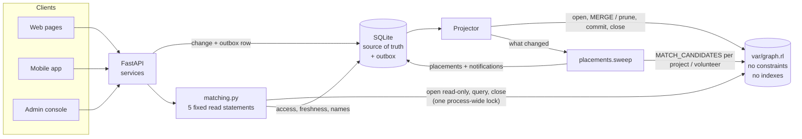
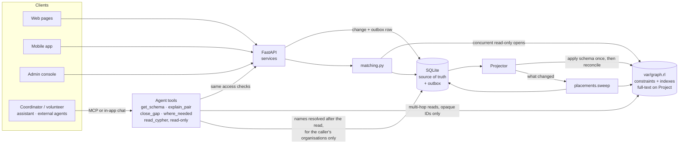

# Relate usage review

A review of how Volunteer Network uses Relate 1.0.1, measured against the Relate by Neo4j
Hackathon 2026 judging criteria, with the current flow and the recommended changes.

Reviewed on 19 November 2026 against `src/app/graph/`, `src/app/matching.py`,
`src/app/placements.py`, `src/app/runtime.py`, `src/app/cli.py` and the Relate tests.
Engine behaviour marked **measured** was checked against `relate-db` 1.0.1 on scratch copies of
`data/demo.rl`. Nothing in the repository was changed apart from adding this file.

## Summary

The Relate integration is correct and carefully built. One Cypher statement makes each matching
decision and returns its own explanation, the graph is a rebuildable projection of SQLite, reads
are bounded, and the tests run against the real engine. I found no correctness bug in the adapter,
the projector or the queries.

The weakness is fit with the hackathon, not code quality:

1. **The entry has no AI or agent capability.** That is one of six equally weighted judging
   criteria, and the theme is "agents that understand how your data connects". This is the largest
   gap and the one worth most of the remaining time.
2. **The graph is used as a filter, not as connected context.** Every read is a fixed two-hop
   volunteer–skill–project join inside one organisation. `ON_TEAM` edges are written and never
   read. Nothing crosses organisations or follows a path longer than two hops.
3. **The graph has no schema.** There are no constraints and no indexes, although every write is
   a `MERGE` on `id`. Relate itself reports a missing index on the main query.
4. **Some documented claims about Relate do not match the engine**, including one the demo
   script relies on.

## Hackathon requirements

Source: Neo4j's announcement post. The Devpost rules page (`relate.devpost.com/rules`) refused
automated access, so **read it yourself before submitting**; it is authoritative.

| Requirement | Status in this entry |
|---|---|
| Built with Relate | Met. Relate is the matching engine. |
| Public GitHub repository with a README that shows how to set it up | Met, once the repository is public. |
| Project description that explains the use case | Drafted in `docs/content/project/devpost.md`. |
| Demo video of 1–2 minutes | Not recorded. The script is 1:45; the optional +20 s shot takes it past 2:00. |
| "Include working code, or the prompts you used with Relate" | Met by the code. |
| "Building on an existing project is fine, as long as the work you submit for judging is new" | Covered by `reuse-and-attribution.md`. |
| Submissions close 11 December 2026, 6 pm Pacific | — |

Judging: "Entries are scored equally on creativity, usefulness, completeness, clarity, effective
use of connected context, and how fully you leveraged AI and agentic capabilities."

| Criterion | Assessment | Main lever |
|---|---|---|
| Creativity | Reasonable. Consent modelled as edges is a good idea. | R1, R2 |
| Usefulness | Strong. A real problem with a complete workflow. | — |
| Completeness | Strong. Web, API, mobile, admin, tests, docs. | R4 |
| Clarity | Strong, apart from the stale claims in F4 and F5. | R4 |
| Effective use of connected context | Moderate. Sound but shallow (F2). | R2 |
| AI and agentic capabilities | **Absent** (F1). | R1 |

## Current flow



How a request uses Relate today:

1. A service function writes SQLite and an outbox row in one transaction.
2. The projector reads the entity's current state from SQLite and reconciles it into Relate in
   one write transaction (upsert the node, prune stale edges, merge current edges).
3. The sweep runs `MATCH_CANDIDATES` for the changed volunteers and projects and updates
   `placements`.
4. A page or API read checks access and pending projections in SQLite, opens the store
   read-only, runs one to three fixed statements, closes it, then drops rows SQLite no longer
   considers published.

Every consumer of the graph is application code running one of five fixed read statements. No
person or agent can ask the graph a question the application did not anticipate, except by
running the `relate` CLI by hand.

## Findings

### F1. No AI or agent surface (high)

There is no LLM call, tool definition, MCP endpoint or agent anywhere in `src/`, `mobile/` or the
docs. The only mention of an agent is in `reuse-and-attribution.md`, listing a template feature
that was removed.

The announcement asks entrants to "show us how connected context makes an agent more reliable,
because it can finally see how things relate instead of guessing." This entry has the connected
context and nothing that consumes it as an agent would.

### F2. The graph is shallow and partly unused (medium)

- **`ON_TEAM` is write-only.** `PROJECT_TEAM_PRUNE` and `PROJECT_TEAM_MERGE` maintain it; no read
  statement in `cypher.py` mentions it. `COVERAGE_GAPS` reports a skill as a gap or as coverable
  without regard to who is already on the team.
- **Every read stays inside one organisation and two hops.** The product's premise is one
  volunteer across several organisations, yet no query crosses organisations. The question a
  spreadsheet per organisation cannot answer ("which organisation I have not joined has a gap I
  could fill?") is not asked.
- **`Skill.category` is a property, not a relationship**, so nothing can traverse from a skill to
  its neighbours ("nobody offers Welsh translation, but two people offer other language skills").
- **`Project.title` and `Project.summary` are stored in the graph and never searched.**
- **`p.status = 'published'` filters on a constant.** The projector only ever writes
  `'published'` and removes a project that stops being live, so the predicate can never exclude
  a row. It is also the predicate Relate flags in F3.

### F3. No constraints or indexes (medium; **measured**)

`SHOW CONSTRAINTS` on `data/demo.rl` returns nothing, and `SHOW INDEXES` returns only the two
built-in lookup indexes. The whole write path is `MERGE (n:Label {id: $id})`, and the graph model
assumes `id` is unique per label, but nothing in the store enforces it.

`PROFILE` on `MATCH_CANDIDATES` returns this notification from the engine:

```text
Relate.Notification.Statement.MissingIndex
the equality predicate on status filters :Project without a range index on (:Project {status})
remedy: CREATE INDEX relate_Project__status FOR (n:Project) ON (n.status)
```

On a scratch copy, the statements below all succeeded on 1.0.1, a duplicate `Volunteer.id` was
then rejected with `IntegrityError`, and the notification disappeared:

```cypher
CREATE CONSTRAINT volunteer_id IF NOT EXISTS FOR (v:Volunteer) REQUIRE v.id IS UNIQUE
CREATE INDEX project_status IF NOT EXISTS FOR (n:Project) ON (n.status)
CREATE FULLTEXT INDEX project_text IF NOT EXISTS FOR (n:Project) ON EACH [n.title, n.summary]
CREATE VECTOR INDEX project_vec IF NOT EXISTS FOR (n:Project) ON (n.embedding)
  OPTIONS {indexConfig: {`vector.dimensions`: 3, `vector.similarity_function`: 'cosine'}}
```

At 38 nodes this has no measurable cost. It matters because judges can run `SHOW CONSTRAINTS`
on the bundled file, and because the model's integrity currently depends on the projector alone.

### F4. The documented lock model is wrong for readers (medium; **measured**)

`store.py`, `relate.md` §5 and §13 and the Devpost draft all say Relate "takes an exclusive lock
on the store for every opener, including read-only ones". On a `.rl` file, 1.0.1 behaves like
this:

| Already open | Second open, read-only | Second open, writable |
|---|---|---|
| Read-only | **Succeeds** (same process and another process) | Fails: `storage locked` |
| Writable | Fails: `storage locked` | Fails: `storage locked` |

Consequences:

- `GraphStore.reader()` takes the same process-wide `RLock` as `write()`, so all reads in the
  web process run one at a time. Readers do not need to exclude each other.
- The demo script's closing claim, that `relate --database var/graph.rl --read-only` works while
  the server runs, is true only because the server holds the store for about a millisecond at a
  time. A long-lived reader (the Relate CLI in interactive use, or `relate serve --read-only`)
  blocks the projector until `GraphBusy`. This matters for R1.
- The lock is detected by `"locked" in str(error).lower()`. The engine classifies it as
  `kind == "StorageError"` with `retryable == False`; `GraphError(str(error))` discards
  `kind`, `neo4j_code`, `gql_status` and `stage` for every failure.

Directory stores behave differently: a read-only open succeeded alongside an open writer
(measured in one process; the Relate docs say the same holds across processes).

### F5. Stale figures in the docs (low)

`README.md:246`, `docs/content/project/relate.md:74` and
`docs/content/project/solution-architecture.md:315` say the bundle has 35 nodes and 67
relationships. The committed `data/demo.rl` has **38 nodes and 78 relationships**, and
`tests/test_relate_store.py:92` asserts 38. The demo's closing card invites judges to run the
count.

### F6. The store is reloaded on every unit of work (low now; the scaling limit)

Relate holds the whole graph in memory, and a read-only open loads it once. The adapter opens and
closes per request, so each request reloads the graph.

| Measured on the demo graph | Time |
|---|---|
| Open read-only, run `MATCH_CANDIDATES`, close | 1.2 ms |
| `MATCH_CANDIDATES` on an already open connection | 0.8 ms |
| Open writable, close | 5.0 ms |

At demo size the reload costs 0.4 ms and is the right trade for letting the CLI in. The cost
grows with the graph, not with the query. **Do not change this for the hackathon.** If the entry
outlives it, the documented pattern is one connection owned by a dedicated worker thread
(connections are thread-affine: a second thread gets `ProgrammingError`, measured), on a
directory store so other processes can still read.

### F7. Engine diagnostics are unused (low)

Every statement returns `elapsed_ms`, `parse_ms`, `plan_ms` and `execute_ms`, and `PROFILE`
returns a structured plan with remedy-bearing warnings. The adapter discards all of it. The
missing index in F3 would have been caught by a test that profiles each read statement.

### What is already right

Keep these, and say so in the submission:

- One statement decides and explains, so the explanation cannot disagree with the decision.
- Eligibility is the shape of the graph: no `VOLUNTEERS_WITH` edge, no match.
- The graph holds opaque IDs only. This becomes the main asset in R1.
- Reconcile-to-current-state projection, which makes replay and reordering harmless.
- `LIMIT $limit` bound by the adapter, raising instead of truncating.
- All values parameterised; labels and types generated only from the fixed schema.
- Real-engine tests, a version pin test, and a bundle drift test.

## Recommended flow



What changes: an agent becomes a fourth client of the same graph; the graph gains a schema and
the relationships that make multi-hop questions possible; readers stop queuing behind each
other. The write path, SQLite's role and the projector's design do not change.

## Recommendations

In priority order for the time left before 11 December.

### R1. Add an agent that reasons over the graph (addresses F1)

Give the graph a tool surface and put an assistant on it. The design already suits this better
than most entries will: **the graph contains no names, emails or notes, so it is a
privacy boundary an agent can be let loose inside.** The agent reasons over opaque IDs; the
application resolves names afterwards, only for the caller's organisations, exactly as
`matching.py` does today. That is a concrete answer to "how does connected context make an agent
more reliable", and it is worth saying in the video.

Tools, each a thin wrapper over `GraphStore.read` behind the existing access checks:

| Tool | Returns | Statement |
|---|---|---|
| `get_schema` | Labels, relationship types and their meaning | From `cypher.LABELS` / `RELATIONSHIPS` |
| `explain_pair(volunteer, project)` | Why this pair does or does not match: the matched skills, or the excluding edge | `MATCH_CANDIDATES` + `EXCLUDED_FOR_VOLUNTEER` scoped to the pair |
| `close_gap(project)` | Volunteers one edge away from covering a gap (has but does not offer; member of a sister organisation; offers a skill in the same category) | New, see R2 |
| `where_needed(volunteer)` | Organisations the volunteer has not joined whose gaps they could fill | New, see R2 |
| `read_cypher(query)` | Rows for an ad-hoc read | Read-only connection, `LIMIT` enforced by the adapter |

Two ways to expose them; do the first, and the second if time allows:

1. **In-app assistant.** A coordinator asks "why can nobody cover Winter Outreach Kitchen, and
   what is the smallest change that fixes it?" on the *Coverage* page; a volunteer asks "why am I
   not matched to this?" on *My matches*. The model calls the tools and answers from the rows.
   Keep it grounded: the answer cites the edges it used.
2. **MCP endpoint**, so any external agent can use the graph. Serve the same tools from the
   FastAPI process.

Do **not** point `relate serve --mcp` at `var/graph.rl`. F4 shows a long-lived reader on a `.rl`
file blocks the projector. Relate's own MCP server is usable only against a copy, or after moving
to a directory store.

`read_cypher` must use `read_only=True`, which makes the engine refuse writes; do not rely on
inspecting the query text.

### R2. Make the context connected (addresses F2)

Each of these is a new statement in `cypher.py` plus, at most, one new relationship type. They
are what R1's tools should call, and they are also worth showing on their own pages.

- **Read `ON_TEAM`.** Make `COVERAGE_GAPS` team-aware: a required skill is covered if a team
  member has and offers it. Add "people you have worked with" as a ranking signal:
  `(v)-[:ON_TEAM]->(:Project)<-[:ON_TEAM]-(peer)-[:ON_TEAM]->(p)`.
- **Cross-organisation discovery** (`where_needed`). From a volunteer, through `OFFERS_SKILL`,
  to projects with an uncovered required skill, in organisations with no `VOLUNTEERS_WITH` edge
  from that volunteer, honouring their cause and skill exclusions. Return organisation and skill
  only. This is the query the product's premise promises and the one a per-organisation
  spreadsheet cannot run.
- **Skill neighbourhood.** Project `(:Skill)-[:IN_CATEGORY]->(:Category)` from the existing
  `category` property. `close_gap` can then say "nobody offers X; these people offer other
  skills in the same category".
- **Near misses** (`close_gap`). Volunteers who `HAS_SKILL` but do not `OFFERS_SKILL` a gap
  skill, shown to the coordinator as a count only, never by name: the volunteer chose not to
  offer it.
- **Search projects.** Add the full-text index from F3 and a `SEARCH` over title and summary on
  the *Projects* page. Vector search over the same text is possible in 1.0.1 but needs an
  embedding model; treat it as optional.

Check each new statement against the existing privacy rule before adding it: a coordinator must
not learn anything about a volunteer who has not opted in to their organisation.

### R3. Declare the schema (addresses F3, F7)

- Add a `SCHEMA` tuple to `cypher.py`, generated from `LABELS`: one uniqueness constraint on
  `id` per label, plus the full-text index if R2 is taken. Use `IF NOT EXISTS`.
- Apply it in the projector's catalogue step, so it reaches new stores, existing stores and the
  bundle by the same path.
- Either drop `p.status = 'published'` from the read statements and the property from
  `PROJECT_UPSERT`, or index it. Dropping is simpler and removes a filter that cannot fail.
- Rebuild the bundle (`uv run task bundle`).
- Tests: assert `SHOW CONSTRAINTS` on the bundle lists one constraint per label; profile every
  bounded read statement and assert no `PERFORMANCE` notification.

### R4. Correct the Relate claims (addresses F4, F5)

- Replace "exclusive lock for every opener, including read-only ones" in `store.py`,
  `relate.md` §5 and §13, and the Devpost draft with the table in F4.
- Update the three "35 nodes and 67 relationships" statements, or better, generate the figure.
- Keep the video inside two minutes: drop the optional shot or shorten another.
- In `GraphStore._open`, detect the lock with `error.kind == "StorageError"` as well as the
  message, and carry `kind` and `neo4j_code` on `GraphError` so logs and `/healthz` can show
  them.

### R5. Let readers run concurrently (addresses F4; optional)

Stop taking the process-wide lock in `reader()`. Read-only opens coexist, and the existing retry
loop in `_open` already handles the moment a writer holds the store. Add a test with two threads
reading at once, and one that a read during a write waits and then succeeds. The gain is
invisible at demo size; do it only if R1 adds enough agent reads to make queuing noticeable.

### Not recommended before the deadline

- Holding one long-lived connection, or moving to a directory store (F6). Both are sound later;
  both touch the adapter's guarantees and the bundled-file story for no visible gain now.
- Relate's ontology procedures and `COMBINE ... USING WRRF` hybrid search. Both are preview
  features behind `RELATE_PREVIEW`.
- Graph algorithms. I found none in the Relate documentation.

## Suggested order of work

| Step | Work | Depends on |
|---|---|---|
| 1 | R4: fix the claims and figures | — |
| 2 | R3: constraints, drop or index `status`, rebuild the bundle, tests | — |
| 3 | R2: team-aware gaps, `where_needed`, `close_gap`, `IN_CATEGORY` | 2 |
| 4 | R1: tools, then the in-app assistant | 3 |
| 5 | Rewrite the demo script and Devpost text around the agent and the cross-organisation query | 4 |
| 6 | R1 MCP endpoint, R5 | 4 |

## How the measurements were made

Scratch copies of `data/demo.rl` and a throwaway directory store, with `relate-db` 1.0.1 from
the project's own virtual environment, on macOS arm64. Timings are means over 200 iterations
(50 for the writable open) and will differ on other hardware. Not verified here: cross-process
reads on a directory store (taken from the Relate docs), and anything on the Devpost rules page.

Sources for the hackathon requirements and Relate features:

- [Announcing the Relate by Neo4j Hackathon 2026](https://neo4j.com/?p=437515)
- [Meet Relate by Neo4j](https://neo4j.com/blog/news/meet-relate-by-neo4j-an-embedded-database-for-ai-agents/)
- [Relate docs](https://relatedb.ai/docs/): indexes and constraints, search, transactions and
  concurrency, MCP server, `relate serve`, limitations
