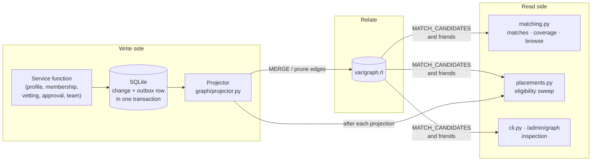
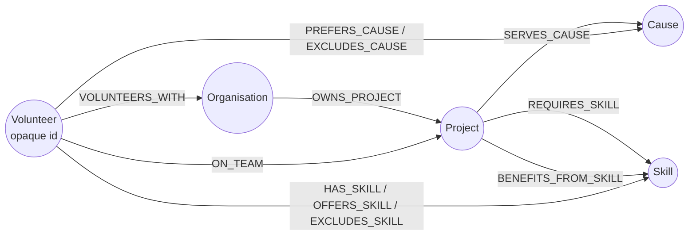

# Relate in this application

This page explains what Relate is, where it sits in the Data Volunteer Network, and exactly how
the application uses it: which files hold the graph, which code opens them, how data gets in,
which query answers which screen, and how to inspect the result yourself.

| | |
|---|---|
| **Engine** | Relate 1.0.1, through the `relate-db` Python package (`import relate`) |
| **Role here** | The matching engine: it decides which volunteers fit which projects, and why |
| **Store** | One file. `data/demo.rl` is bundled and read-only; the app works on a copy at `var/graph.rl` |
| **Code** | `src/app/graph/` (adapter, Cypher, projector, AuraDB), `src/app/matching.py`, `src/app/placements.py` |
| **Not in the graph** | Names, emails, passwords, sessions, review notes. Volunteers are opaque IDs. |

## 1. What Relate is

Relate is an embedded graph database that is queried in Cypher. It runs inside the application's
own process: there is no server to start and no network connection. Its package describes it as
an in-memory property-graph engine written in Rust, made durable by a write-ahead log and
checkpoints, with the graph held in memory, in a directory or in a single `.rl` file. This
application uses the single-file form only.

Relate comes from Neo4j Labs. The package's own description calls it "an experimental Neo4j Labs
project, not part of Neo4j's supported product lineup". Its documentation is at
[relatedb.ai/docs](https://relatedb.ai/docs/) and its source repository is
[github.com/relatedb/relate](https://github.com/relatedb/relate).

Two pieces of Relate are used here:

| Piece | Version | How it is installed | What uses it |
|---|---|---|---|
| `relate-db` (Python binding, PEP 249) | 1.0.1, pinned in `pyproject.toml` and `uv.lock` | `uv sync --locked` | The application, the CLI and the tests |
| `relate` command-line tool | 1.0.1 | Separately, from the [Relate install guide](https://relatedb.ai/docs/get-started/install/) | Optional inspection of the same `.rl` files |

The binding and the command-line tool are pinned to the same version so that either can open a
file the other wrote. A test checks the pin (`tests/test_relate_store.py`).

## 2. Where Relate sits

SQLite is the source of truth. Relate is a read model that is rebuilt from it. Nothing is ever
written to Relate first.



The split is deliberate:

- **Relate decides.** Whether a volunteer matches a project is answered by one Cypher query that
  follows relationships. No application code re-implements the rules.
- **SQLite checks.** Around each graph read, SQLite is asked three things only: may this user see
  this organisation, is a graph update still pending, and what are the display names.

## 3. The files

| File | What it is | Who writes it |
|---|---|---|
| `data/demo.rl` | The bundled demo graph: 35 nodes and 67 relationships. Committed, read-only (mode 444). Packaged into the wheel as `app/demo.rl`. | `uv run task bundle` only |
| `var/graph.rl` (or `/data/graph.rl` in Compose) | The writable store the running application uses. Git-ignored. | The projector |

On a first start with an empty data directory, `runtime.seed_demo` copies `data/demo.rl` to
`var/graph.rl`, makes the copy writable by its owner only, and then projects the demo data on top
of it. The bundled file is never opened for writing.

`uv run task bundle` rebuilds `data/demo.rl` from `data/fixtures/` by seeding into a temporary
directory and keeping the resulting store. A test fails if the committed file differs from a
fresh build, so the bundle cannot drift from the fixtures.

`uv run task reset` deletes the writable store and the SQLite database, then seeds again.

The location is set by `DATA_DIR` (default `var`). The row bound for reads is `GRAPH_MAX_ROWS`
(default 500).

## 4. The graph model



| Node | Properties | Comes from (SQLite) |
|---|---|---|
| `Organisation` | `id`, `name` | `organisations` |
| `Project` | `id`, `title`, `summary`, `revision`, `status` (always `published`) | The approved revision of a `submissions` row |
| `Cause` | `id`, `name` | `causes` (the shared catalogue) |
| `Skill` | `id`, `name`, `category` | `skills` (the shared catalogue) |
| `Volunteer` | `id` only | `users.id` |

| Relationship | Meaning | Exists when |
|---|---|---|
| `OWNS_PROJECT` | The organisation runs the project | The project's approved revision has been projected |
| `SERVES_CAUSE` | The project's one cause | As above |
| `REQUIRES_SKILL` | A skill the project needs | As above |
| `BENEFITS_FROM_SKILL` | An optional skill | As above |
| `VOLUNTEERS_WITH` | The volunteer can be matched in this organisation | They are opted in **and** their account is `active` (vetted) |
| `HAS_SKILL` | The volunteer has the skill | Profile state is "have" or "have and offer" |
| `OFFERS_SKILL` | The volunteer is willing to be matched on it | Profile state is "have and offer" |
| `EXCLUDES_SKILL` | Never match me on a project that requires this | Profile state is "exclude" |
| `PREFERS_CAUSE` / `EXCLUDES_CAUSE` | The volunteer's stance on a cause | Profile stance is "prefer" or "exclude" |
| `ON_TEAM` | The volunteer is on the project's team | The volunteer and the project lead both said yes |

Two rules are enforced by the shape of the graph itself, not by a filter in the application:

- A volunteer who has not been vetted has no `VOLUNTEERS_WITH` relationship, so no matching query
  can reach them.
- A project that is not approved and published is not in the graph at all.

This model is defined once, as `LABELS` and `RELATIONSHIPS` in `src/app/graph/cypher.py`. The
statements that write the graph, the projector and the AuraDB push are all generated from or
checked against that one definition. A test asserts that it lists exactly the relationship types
found in `data/demo.rl`.

## 5. The adapter: how the application talks to Relate

`src/app/graph/store.py` is the only module that imports `relate`. Everything else goes through
its `GraphStore` class.

```python
from app.graph.store import GraphStore

graph = GraphStore("var/graph.rl", max_rows=500)

# One atomic write: committed on success, rolled back on any exception.
with graph.write() as tx:
    tx.run("MERGE (o:Organisation {id: $id}) SET o.name = $name", {"id": "org_1", "name": "A"})

# Several reads on one open store.
with graph.reader() as tx:
    rows = tx.read("MATCH (o:Organisation) RETURN o.id AS id, o.name AS name LIMIT $limit")

# A single read.
rows = graph.read("MATCH (n) RETURN count(n) AS nodes")
```

Underneath, the adapter uses the binding's standard database interface: `relate.connect(path,
read_only=...)`, a cursor, `execute(statement, parameters)`, `fetchmany`, and `commit` or
`rollback`. Each row is returned as a dictionary.

The adapter adds four guarantees.

**Every value is a parameter.** Statements are fixed text in `cypher.py`; values are always bound
(`$id`, `$orgs`), never formatted into the query. Labels and relationship types are the only
parts that are generated, and they come from the fixed schema.

**One writer, opened per unit of work.** Relate takes an exclusive lock on the store for every
opener, including read-only ones. The adapter therefore opens the store, does one piece of work
and closes it again (about 0.2 ms on the demo graph), and a lock per file serialises access
inside the process. This is why the `relate` command-line tool can read `var/graph.rl` while the
server is running.

**Bounded retry when another process holds the lock.** If the store is locked by another process
(the command-line tool, for example), the adapter retries up to 40 times with a growing pause and
then raises `GraphBusy`.

**Reads are bounded and never silently cut short.** Every statement that can return many rows
ends in `LIMIT $limit`. The adapter binds `$limit` itself, to `max_rows + 1`. If more than
`max_rows` rows come back it raises `GraphTruncated`. A caller cannot pass its own smaller limit
and mistake a partial answer for a complete one.

| Error | Meaning | What the user sees |
|---|---|---|
| `GraphError` | A statement failed, or the store is missing | 503 "Matching unavailable" page, or JSON `{"detail": ...}` |
| `GraphBusy` | Another process kept the store locked for the whole retry window | 503 with "The matching graph is busy" |
| `GraphTruncated` | A read exceeded `GRAPH_MAX_ROWS` | 503; raise the bound or narrow the query |

## 6. How data gets into Relate: the projector

No request writes to Relate directly. A service function changes SQLite and adds an **outbox**
row in the same transaction. The projector (`src/app/graph/projector.py`) then brings the graph
up to date.

```mermaid
sequenceDiagram
  participant S as Service
  participant Q as SQLite
  participant P as Projector
  participant R as Relate
  participant W as Sweep
  S->>Q: change + outbox row (one transaction)
  P->>Q: read due outbox rows
  P->>Q: read the entity's current state
  P->>R: one write transaction: upsert node, prune stale edges, merge current edges
  P->>Q: mark the row done (or record the error and back off)
  P->>W: what changed (volunteers, projects)
  W->>R: MATCH_CANDIDATES for those only
  W->>Q: create, lapse or revive placements; notify
```

An outbox row names an entity, not an event. The projector reads that entity's *current* state
from SQLite and makes the graph match it. Replaying a row is therefore harmless, and the order in
which rows are processed does not matter.

| Outbox kind | Written when | Cypher run (in one Relate transaction) |
|---|---|---|
| `catalogue` | The cause and skill catalogue changes at start-up | `UPSERT_CAUSES`, `UPSERT_SKILLS` |
| `organisation` | An organisation is seeded or created by a system admin | `UPSERT_ORGANISATION` |
| `volunteer` | A profile is saved; a volunteer joins, leaves or is removed from an organisation; a vetting decision changes their status | `VOLUNTEER_UPSERT`, then for each of the six volunteer relationship types `VOLUNTEER_EDGE_PRUNE` and `VOLUNTEER_EDGE_MERGE` |
| `project` | A suggestion is approved or withdrawn; a team changes | `PROJECT_UPSERT`, `PROJECT_EDGE_PRUNE` and `PROJECT_EDGE_MERGE` for each project relationship type, `PROJECT_TEAM_PRUNE`, `PROJECT_TEAM_MERGE`, `PROJECT_OWNED`; or `PROJECT_REMOVE` when it is no longer live |

The prune-then-merge pair is how one relationship type is reconciled:

```text
MATCH (n:Volunteer {id: $id})-[r:OFFERS_SKILL]->(t:Skill)
WHERE NOT t.id IN $targets
DELETE r
```

```text
MATCH (n:Volunteer {id: $id})
UNWIND $targets AS target
MATCH (t:Skill {id: target})
MERGE (n)-[:OFFERS_SKILL]->(t)
```

`$targets` is the list the volunteer has *now*. Edges to anything else are deleted, and the
listed ones are merged, so running it twice changes nothing.

When the projector runs:

- straight after each change, inside the request that made it;
- in a background loop every `PROJECTOR_INTERVAL_SECONDS` (5 by default);
- at start-up, which replays anything a crash left pending;
- from `python -m app.cli drain`, and from the admin console's *Replay outbox now* button.

A failed projection stays in the outbox with its error and an exponential back-off capped at 60
seconds. After three attempts it is reported as failing by `/healthz`, `python -m app.cli status`
and the console's *System* tab. It is still retried.

A project becomes **Active** (`published`) only after its approved revision has been written to
Relate. Until then it is "Approved (activating…)" and no one is matched to it.

## 7. The queries, and what each one is for

Every statement the application runs is in `src/app/graph/cypher.py`. These are the read
statements.

| Statement | Answers | Called by | Reaches the user as |
|---|---|---|---|
| `MATCH_CANDIDATES` | Which volunteers match which published projects, with matched, optional and remaining skills and the preferred-cause flag | `matching.volunteer_matches`, `matching.project_coverage`, `placements.sweep`, `cli matches`, `aura.parity` | Web *Home*, *My matches*, *Profile* and project pages; `GET /orgs/{org}/matches` and `/coverage`; mobile *Matches*; eligibility notifications |
| `COVERAGE_GAPS` | Required skills no eligible volunteer in the organisation can cover | `matching.project_coverage` | Web *Coverage* and the reviewer's project page; `GET /orgs/{org}/coverage`; admin console |
| `EXCLUDED_FOR_VOLUNTEER` | Which projects the volunteer's own exclusions hide, and why | `matching.volunteer_matches` | "Hidden by your exclusions" on *My matches*; `excluded` in the matches API. Shown to that volunteer only. |
| `OPTIONAL_SKILLS_EXCLUDED` | Optional skills left out of a match because the volunteer excluded them | `matching.volunteer_matches` | The explanation on a match |
| `BROWSE_PROJECTS` | An organisation's published projects (or one of them) with their skills | `matching.browse`, `matching.project`, `matching.project_coverage` | Web *Projects* and project detail; `GET /orgs/{org}/projects` |
| `INSPECT` | Organisation → project → cause → skill → eligible volunteers | `cli inspect`, `GET /admin/graph` | `uv run task inspect`; admin console *System* tab |
| `COUNT_LABELS`, `COUNT_RELATIONSHIPS` | How many nodes and relationships of each kind | `GET /admin/graph` | Admin console *System* tab |
| `ALL_NODES`, `ALL_RELATIONSHIPS` | The whole graph | `aura.push`, tests | The optional AuraDB push; the bundle drift test |

### The matching query

`MATCH_CANDIDATES` is the heart of the application. One statement makes the decision and returns
its explanation.

```text
MATCH (o:Organisation)-[:OWNS_PROJECT]->(p:Project)-[:SERVES_CAUSE]->(c:Cause)
WHERE o.id IN $orgs AND p.status = 'published' AND ($project = '' OR p.id = $project)
MATCH (v:Volunteer)-[:VOLUNTEERS_WITH]->(o)
WHERE ($volunteer = '' OR v.id = $volunteer)
  AND NOT (v)-[:EXCLUDES_CAUSE]->(c)
  AND NOT EXISTS { MATCH (p)-[:REQUIRES_SKILL]->(:Skill)<-[:EXCLUDES_SKILL]-(v) }
MATCH (p)-[:REQUIRES_SKILL]->(s:Skill)<-[:HAS_SKILL]-(v)
WHERE (v)-[:OFFERS_SKILL]->(s)
WITH o, p, c, v, collect(DISTINCT s.id) AS matched
OPTIONAL MATCH (p)-[:BENEFITS_FROM_SKILL]->(os:Skill)<-[:OFFERS_SKILL]-(v)
WHERE (v)-[:HAS_SKILL]->(os) AND NOT (v)-[:EXCLUDES_SKILL]->(os)
WITH o, p, c, v, matched, collect(DISTINCT os.id) AS optional_matched
CALL (p) {
  MATCH (p)-[:REQUIRES_SKILL]->(r:Skill)
  RETURN collect(r.id) AS required
}
WITH o, p, c, v, matched, optional_matched, required,
     EXISTS { MATCH (v)-[:PREFERS_CAUSE]->(c) } AS preferred
WHERE NOT $preferred_only OR preferred
RETURN o.id AS org, p.id AS project, p.title AS title, p.revision AS revision,
       c.id AS cause, c.name AS cause_name, v.id AS volunteer,
       matched, optional_matched, required,
       [r IN required WHERE NOT r IN matched] AS remaining,
       preferred, size(matched) AS coverage, size(optional_matched) AS optional_coverage
ORDER BY preferred DESC, coverage DESC, optional_coverage DESC, project, volunteer
LIMIT $limit
```

How each line of the matching rules maps to the query:

| Rule | Where it is in the query |
|---|---|
| Only published projects of the organisations in scope | `(o)-[:OWNS_PROJECT]->(p)` with `o.id IN $orgs` and `p.status = 'published'` |
| Only opted-in, vetted volunteers | `(v)-[:VOLUNTEERS_WITH]->(o)` |
| An excluded cause removes the pair | `NOT (v)-[:EXCLUDES_CAUSE]->(c)` |
| An excluded required skill removes the pair, even if another skill fits | `NOT EXISTS { (p)-[:REQUIRES_SKILL]->(:Skill)<-[:EXCLUDES_SKILL]-(v) }` |
| The volunteer must have **and** offer a required skill | `(p)-[:REQUIRES_SKILL]->(s)<-[:HAS_SKILL]-(v)` with `(v)-[:OFFERS_SKILL]->(s)` |
| Optional skills count unless excluded | The `OPTIONAL MATCH` on `BENEFITS_FROM_SKILL` |
| A preferred cause ranks first | `EXISTS { (v)-[:PREFERS_CAUSE]->(c) } AS preferred`, then `ORDER BY preferred DESC` |
| What is still needed from others | `[r IN required WHERE NOT r IN matched] AS remaining` |

The same statement serves three questions by its parameters: one volunteer's matches
(`$volunteer`), one project's candidates (`$project`), or a whole organisation (both empty).
`cypher.match_params()` builds the parameters so every caller passes the same set.

### Around each read

`src/app/matching.py` wraps the graph reads with the SQLite checks:

1. **Access.** The caller's standing in the target organisation. A volunteer may ask only about
   organisations they are opted in to; coverage needs the reviewer role.
2. **Status.** A volunteer who is not yet `active` is told their account is awaiting approval.
3. **Freshness, before the read.** If an outbox row that could change the answer is still pending,
   the result is **withheld** with a reason, and nothing is read from the graph.
4. **The read**, bounded as described above.
5. **Freshness, after the read.** Rows for projects that SQLite no longer lists as published are
   dropped, and a candidate is named only if they are still opted in.

## 8. From a match to a team: the placement sweep

`src/app/placements.py` turns graph matches into offers.

After the projector has written to Relate, it tells the sweep which volunteers and projects
changed. The sweep runs `MATCH_CANDIDATES` for those only, one project or one volunteer at a
time, and compares the result with the `placements` table:

- a new pair becomes an `eligible` placement, and the volunteer and the project lead are notified;
- an `eligible` pair that no longer matches becomes `lapsed`;
- a `lapsed` pair that matches again becomes `eligible` again.

Because each read is for one project or one volunteer, the row bound applies to that one entity
and not to an organisation as a whole. A read that would exceed the bound fails the sweep, which
is retried in full on the next drain. No offer is ever closed on the strength of a partial
answer.

A full sweep of every published project runs at start-up, on `python -m app.cli drain`, on an
admin replay, when the catalogue or an organisation changes, and after a sweep that failed.

When the volunteer and the lead have both said yes, the placement becomes `team` and a `project`
outbox row is written. The projector then adds `(:Volunteer)-[:ON_TEAM]->(:Project)`.

## 9. Inspecting the graph

| Way in | Command or place | Shows |
|---|---|---|
| Task | `uv run task inspect` | The `INSPECT` table for the bundled `data/demo.rl` |
| Application CLI | `uv run python -m app.cli inspect [--store PATH] [--json]` | The same, for any store; the default is the writable one |
| Application CLI | `uv run python -m app.cli matches --org datakind-uk [--store PATH]` | Ranked candidates for one organisation |
| Application CLI | `uv run python -m app.cli status` / `drain` | Outbox status; project pending rows now |
| Admin console | *System* tab (system admins) | Node and relationship counts, the inspection table, projection health, *Replay outbox now* |
| JSON API | `GET /api/v1/admin/graph`, `GET /api/v1/admin/projection` | The same data as the console |
| Relate CLI | `relate --database data/demo.rl --read-only --mode table "<cypher>"` | Any query you like |

With the Relate command-line tool installed:

```sh
relate --version                                   # Relate v1.0.1
relate --database data/demo.rl --read-only --mode table \
  "MATCH (n) RETURN labels(n)[0] AS label, count(n) AS nodes ORDER BY label"
relate --database var/graph.rl --read-only --mode table \
  "MATCH (v:Volunteer)-[:ON_TEAM]->(p:Project) RETURN v.id AS volunteer, p.title AS project"
```

The second command works while the server is running, because the server holds the store only
for the moment it is using it. Volunteer IDs are opaque in the graph; `app.cli inspect` adds the
demo names for readability.

## 10. Relate and AuraDB

The Cypher is written in the Neo4j 5 dialect, so the same statement text runs on Neo4j AuraDB.
Two commands use that, and neither runs on a request path:

- `python -m app.cli aura-push` copies the Relate graph to a designated development AuraDB
  instance with the Neo4j Python driver. Every node it writes is tagged `dvn_scope`, and it
  deletes only nodes with that tag. Labels and relationship types are checked against the schema
  before anything is deleted.
- `python -m app.cli aura-parity` runs `MATCH_CANDIDATES` on both engines for each organisation
  and compares the rows.

Both are tested against a stand-in for the driver. Neither has been run against a live AuraDB
instance; see the [verification record](verification.md).

## 11. Cypher features the application relies on

All of these are exercised by the test suite against Relate 1.0.1.

| Feature | Used for |
|---|---|
| `MERGE` on a node key, `SET` | Idempotent upserts of every node |
| `UNWIND $rows` / `UNWIND $targets` | Batch upserts and edge merges |
| `DELETE`, `DETACH DELETE` | Pruning stale edges; removing a withdrawn project |
| Pattern predicates in `WHERE`, such as `NOT (v)-[:EXCLUDES_CAUSE]->(c)` | Exclusions and the offer check |
| `EXISTS { MATCH ... }` and `NOT EXISTS { ... }` | Required-skill exclusions, the preferred-cause flag, coverage gaps |
| Scoped subqueries, `CALL (p) { ... }` | Collecting a project's required and optional skills |
| `OPTIONAL MATCH`, `collect(DISTINCT ...)` | Optional skills; lists of matched skills |
| List comprehension, `[r IN required WHERE NOT r IN matched]` | The skills still needed |
| `labels(n)`, `type(r)`, `properties(n)` | Counts, the export and the schema test |
| Named parameters (`$name`), `ORDER BY`, `LIMIT $limit` | Every statement |

Not used: Relate's in-memory and directory stores, and the binding's optional pandas and Arrow
result helpers.

## 12. Tests that cover Relate

Every test builds a temporary SQLite database and a real Relate store. Nothing is mocked except
the AuraDB driver.

| File | Covers |
|---|---|
| `tests/test_relate_store.py` | The version pin; write, close and reopen; rollback; lock retry then `GraphBusy`; bounded reads; that a `$limit` cannot hide truncation; the bundle matching a fresh build; the Relate CLI reading the bundle |
| `tests/test_projection.py` | Start-up projection, idempotent replay, failure and back-off, withheld results, "approved but not published until projected", persistence across restarts |
| `tests/test_matching.py` | One test for each row of the matching rules, the preferred-only filter, and profile edits reaching Relate |
| `tests/test_placements.py` | The sweep beyond the row bound, a truncated read failing loudly, scoped sweeps, lapse and revive, full sweep on replay |
| `tests/test_graph_schema.py` | The schema matching `data/demo.rl`; the AuraDB push and parity check against a stand-in driver |
| `tests/test_rbac_onboarding.py` | `VOLUNTEERS_WITH` only after vetting; `ON_TEAM` after both say yes |

## 13. Known limits

- **One process writes.** Relate's exclusive lock means a second process waits and may get
  `GraphBusy`. The admin console avoids this by going through the API and never opening the store.
- **Reads are capped** at `GRAPH_MAX_ROWS` per statement. Beyond that the application reports an
  error instead of a partial list.
- **Relate is experimental.** It is a Neo4j Labs project and not a supported Neo4j product, which
  is one reason SQLite stays the source of truth: the graph can always be rebuilt from it.
