# Volunteer Network: Solution Architecture

| | |
|---|---|
| **System** | Volunteer Network (the hackEntry repository), a hackathon build |
| **Scope** | Web app, JSON API, Ionic mobile app, Streamlit admin console, Relate graph, optional AuraDB |
| **Status** | Working build, verified locally and under Docker Compose |
| **Engines** | Python 3.14, Relate 1.0.1 (embedded `relate-db`), SQLite (WAL) |
| **Companion docs** | [README](https://github.com/TheCyberScallywag/hackEntry/blob/main/README.md), [Relate in this application](relate.md), [tooling](tooling.md), [verification record](verification.md), [demo script](demo-script.md), [reuse and attribution](reuse-and-attribution.md) |

---

## Contents

1. [Purpose and scope](#1-purpose-and-scope)
2. [Architecture at a glance](#2-architecture-at-a-glance)
3. [Tools and technology](#3-tools-and-technology)
4. [Logical components](#4-logical-components)
5. [Data architecture](#5-data-architecture)
6. [Security, identity and access control](#6-security-identity-and-access-control)
7. [Core workflows](#7-core-workflows)
8. [API surface](#8-api-surface)
9. [Functions by module](#9-functions-by-module)
10. [Deployment and operations](#10-deployment-and-operations)
11. [Quality and verification](#11-quality-and-verification)
12. [Architecture decisions](#12-architecture-decisions)
13. [Limitations and next steps](#13-limitations-and-next-steps)

---

## 1. Purpose and scope

The Volunteer Network matches **vetted volunteers** with **approved projects** run by
partner organisations. It suggests a match when a volunteer has and offers the skills a project
needs, and never when the project touches a cause or skill the volunteer has excluded. The
illustrative organisations, *DataKind UK*, *Cyber Scallywags* and *InterLinkRCT*, can be renamed with
`ORG_NAMES`; no endorsement is implied.

The solution covers:

- **Identity:** signup, sign-in and sign-out, with server-side authorisation on every action.
- **Volunteer onboarding:** profile, then vetting by a moderator, then active, then matched,
  then on a team.
- **Onboarding workflows:** each organisation, and each project, can ask new joiners to work
  through its own ordered steps, with an optional email at each one.
- **Project onboarding:** a suggestion can be saved as a private draft; once submitted it is
  reviewed by the organisation, may be sent back for scoping, and is then approved and made
  active.
- **Matching** on a graph engine (Relate), with explainable results and coverage gaps.
- **Three clients** on one backend: server-rendered web pages, an Ionic mobile app and a
  Streamlit admin console.
- **In-app notifications** at every state change, and onboarding emails over SMTP.
- **Optional AuraDB** push and parity check, run only on request.

**Out of scope:** SMS and push delivery, email beyond the onboarding emails, production hosting, single sign-on, and publishing to
app stores.

---

## 2. Architecture at a glance

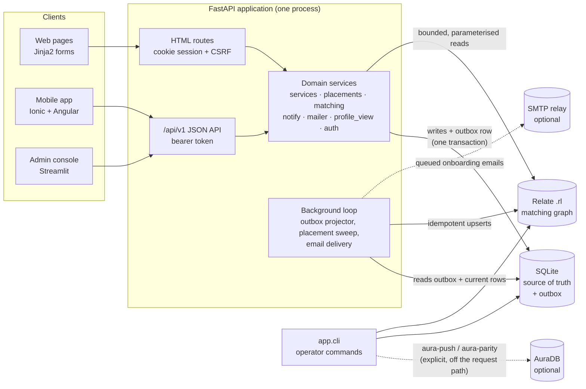

**Design principles**

1. **SQLite is the source of truth; Relate is a derived read model.** Every change is written to
   SQLite with an outbox row in the same transaction. The graph is rebuilt from that state.
2. **The graph holds no personal data.** Volunteers appear as opaque IDs only: no names, emails,
   sessions or review notes.
3. **Every action is a FastAPI endpoint.** The mobile app and the admin console use only
   `/api/v1`. The web pages call the same service functions in-process.
4. **Authorise on the server, every time.** Clients only hide what they can't use; the API
   checks again on every call.
5. **Don't show a stale answer.** When a relevant graph update is still pending, results are
   withheld and the user is told why, rather than shown out-of-date matches.

---

## 3. Tools and technology

This section is the summary. [Tooling](tooling.md) lists every tool with its configuration and
commands, including the tasks, the pre-commit hooks, CI and the docs toolchain.

### 3.1 Runtime stack

| Layer | Tool | Version | Role |
|---|---|---|---|
| Language | CPython | 3.14 | Application runtime |
| Packaging | uv + `uv.lock` | latest | Reproducible environments, task runner via taskipy |
| Web framework | FastAPI | 0.162 | JSON API, HTML routes, OpenAPI docs at `/api/docs` |
| Data models | Pydantic | 2.14 | Request bodies and response models: the API contract |
| ASGI server | Uvicorn | 0.54 | HTTP server (`python -m app.serve web`) |
| Templates | Jinja2 | 3.1 | Server-rendered pages, no client JavaScript needed |
| Forms | python-multipart | locked | Form parsing |
| Config | pydantic-settings | 2.16 | Typed settings from env and `.env` |
| Passwords | argon2-cffi | 25.1 | Argon2id hashing |
| Graph engine | **Relate** (`relate-db`), a Neo4j Labs project | **1.0.1** | Embedded, single-file `.rl` graph; Cypher; PEP 249 driver. See [Relate in this application](relate.md). |
| Transactional store | SQLite (stdlib) | bundled | WAL mode, `BEGIN IMMEDIATE`, schema version 9 |
| Assistants | Pydantic AI (`pydantic-ai-slim[anthropic]`), `pydantic-graph` | 2.71 | Six agents over the service layer; off until `AGENT_MODEL` is set. See [7.7](#77-assistants). |
| Evaluation | `pydantic-evals` | 2.71 | Evaluators on every live run, and offline datasets (`app.cli evals`) |
| Observability | Pydantic Logfire | 6.0 | Traces, metrics and evaluation results; sent only when `LOGFIRE_TOKEN` is set |
| Email | `smtplib` (stdlib); Mailpit in Compose | bundled | Onboarding emails from an outbox table; nothing is sent without `SMTP_HOST` |
| Optional graph | Neo4j Python driver → AuraDB | 6.4 | `aura-push` and `aura-parity` only |
| Admin console | Streamlit + httpx + pandas | 1.67 / 0.28 / 3.1 | Staff UI, a client of the JSON API only |

### 3.2 Mobile stack

| Tool | Version | Role |
|---|---|---|
| Angular | 22.2 | Standalone components, signals, functional guards and interceptors |
| Ionic | 9 | Mobile UI components (accordions, lists, menu, badges) |
| Capacitor | 8.5 | Native shell (optional, for packaging later) |
| TypeScript | 6.0 | Language |
| Vitest | 5.0 | Unit tests (39 tests in 11 spec files) |
| nginx | stable | Serves the built app and proxies `/api/` to the web service in Compose |

### 3.3 Engineering tooling

| Tool | Use |
|---|---|
| pytest 9 + coverage | 365 backend tests, with line coverage on every run; `aura` and `compose` markers for gated tests |
| Admin console tests | `tests/test_admin_console.py` drives the console for each role through a small stand-in for Streamlit, against the real API |
| Ruff 0.17 | Lint and format (line length 100) |
| ESLint + Angular CLI | Mobile lint and production build |
| Docker + Docker Compose | Two-command clean start: services `web`, `admin`, `mobile`, `docs` and `mail` (Mailpit), plus `tunnel` on request; volume `dvn-data` |
| GitHub Actions | CI: Python lint and tests against the locked environment, a strict docs build, mobile lint and tests (in Docker), Compose smoke test. CodeQL runs separately. |
| Dependabot | Weekly grouped updates for uv, npm, GitHub Actions and Docker base images |
| pre-commit | Hooks for file hygiene, Ruff, the lock file, workflow syntax, branch names and commit prefixes |
| Zensical, and Sphinx with Furo | The docs portal and the reference manual, built from the same pages, warnings as errors |
| taskipy | The `uv run task ...` commands |
| Relate CLI 1.0.1 | Optional inspection of the same `.rl` files (`relate ...`) |

### 3.4 Why Relate

[Relate in this application](relate.md) describes the integration in full: the files, the
adapter, the projector, each query and how to inspect the graph.

- **Embedded and single-file.** It needs no server and is opened in-process. A demo graph
  (`data/demo.rl`) is bundled with the package and copied for each reset.
- **Cypher.** Matching rules read naturally as patterns: `EXISTS {}` exclusions, scoped
  `CALL (p) {}` subqueries and `UNWIND` upserts. The same text runs on AuraDB, which is what makes
  the parity check possible.
- **Persistent.** Data survives a restart, and the tests reopen the store to prove it.
- **Constraint handled:** Relate locks the store exclusively, even for reads. The adapter
  therefore opens one connection per unit of work (well under a millisecond on the demo graph), serialises access with a
  per-path lock and retries a bounded number of times before raising `GraphBusy` (a 503 response).

---

## 4. Logical components

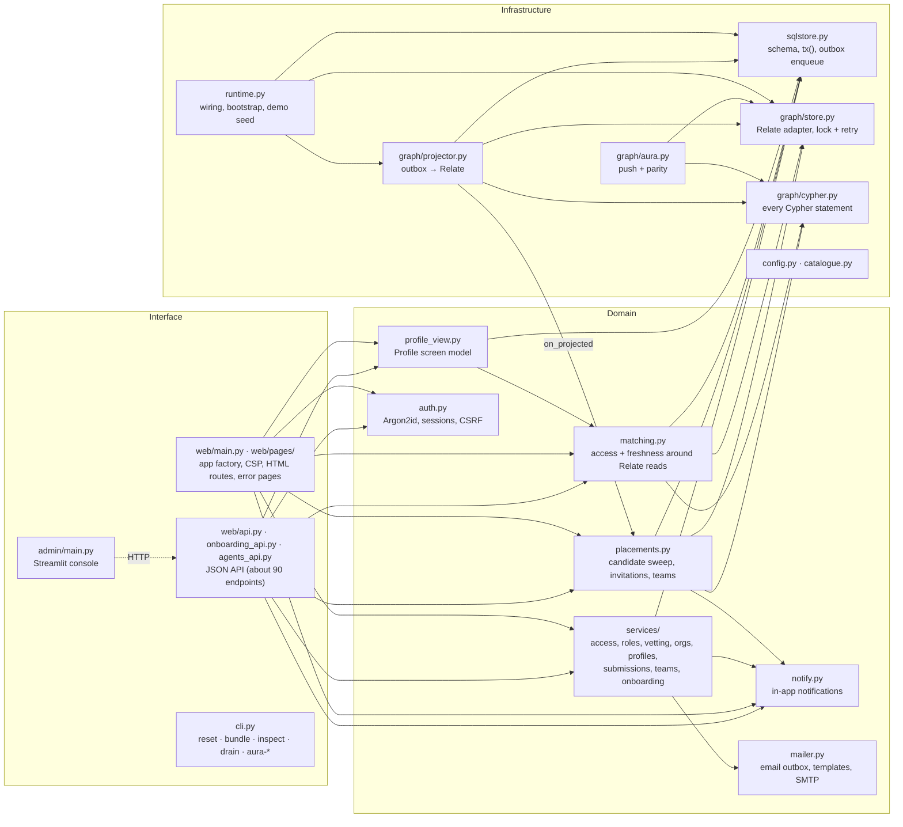

| Component | Responsibility | Size (lines) |
|---|---|---|
| `web/api.py` | The core actions as typed JSON endpoints, grouped by tag | 626 |
| `web/onboarding_api.py` | The onboarding workflows of organisations and projects, email templates and sent emails | 447 |
| `web/agents_api.py` | The assistants and the audit trail | 316 |
| `web/schemas.py` | Every request body and response model: the API contract | 540 |
| `web/main.py` | App factory, CSP, docs mount, health check, audit middleware, the background loop | 160 |
| `web/pages/` | The HTML pages, one router per area (account, onboarding, organisations, projects, suggestions) | 669 |
| `web/deps.py`, `web/errors.py` | Session, CSRF-checked forms, rendering; one table of error responses for pages and API | 402 |
| `services/` | Domain operations and **all authorisation decisions**, one module per area | 2,446 |
| `services/onboarding.py` | Workflows, steps, email templates, a volunteer's run through them | 819 |
| `services/teams.py` | Standing, the lead side, the lead's automatic team place, ending places, the placement event history | 245 |
| `placements.py` | Onboarding step 2: candidate, invited by the lead side, team onboarding, on the team; suspension, reopening, reminders and expiry | 752 |
| `matching.py` | Org access, account status, pending-update withholding, explanations | 293 |
| `mailer.py` | Placeholder checking and rendering, the email outbox, SMTP delivery with retries | 188 |
| `graph/projector.py` | Outbox drain, reconcile per entity, backoff, hook into the sweep | 412 |
| `graph/cypher.py` | The graph schema and all Cypher, with fixed labels and parameter-bound values | 457 |
| `graph/store.py` | Relate connection per unit of work, lock, retry, row cap | 139 |
| `sqlstore.py` | Schema (27 tables), transactions, outbox enqueue, pruning | 531 |
| `auth.py` | Argon2id, opaque sessions, CSRF comparison | 152 |
| `admin/main.py` | Role-based staff console over the API, one function per section | 743 |
| `mobile/src/app` | Ionic pages: sign-in, matches, suggestions, profile, opportunities, notifications | n/a |

---

## 5. Data architecture

### 5.1 Responsibilities of each store

| Concern | SQLite | Relate | AuraDB |
|---|---|---|---|
| Accounts, password hashes, sessions | ✔ | ✘ | ✘ |
| Roles, vetting history, review notes | ✔ | ✘ | ✘ |
| Profiles (skills, causes, memberships) | ✔ authoritative | ✔ projected (IDs only) | copy on push |
| Submissions and revisions | ✔ authoritative | ✔ active projects only | copy on push |
| Placements and teams | ✔ authoritative | ✔ `ON_TEAM` edges | copy on push |
| Onboarding workflows, steps and each volunteer's progress | ✔ authoritative | ✔ projected (steps, `AT_STEP`, `COMPLETED_STEP`) | copy on push |
| Email templates, queued and sent emails | ✔ | ✘ | ✘ |
| Notifications | ✔ | ✘ | ✘ |
| Audit trail, assistant runs | ✔ | ✘ | ✘ |
| Matching and coverage queries | ✘ | ✔ | parity check only |

### 5.2 Relational model (SQLite, schema version 9)

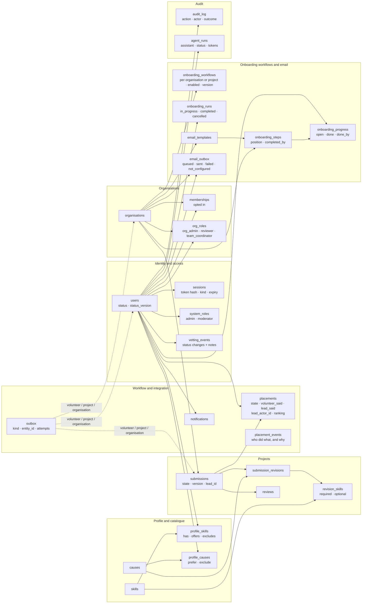

Key columns:

- **`users`:** `status` (draft, screening, info_requested, active, declined, suspended),
  `status_version`, `profile_version`, `vetted_by`, `vetted_at`.
- **`submissions`:** `state`, `current_revision`, `version`, `lead_id` (the author by default).
- **`placements`:** `state` (eligible, onboarding, team, suspended, declined, lapsed, removed,
  left), `volunteer_said`,
  `lead_said`, `lead_actor_id` (who answered for the lead side), `lead_note`, `invited_at`,
  `reminded_at`, `matched_skills`, `optional_skills`, `preferred`, `version`.
- **`placement_events`:** one row per change to a placement: `event`, `actor_id` (empty when the
  system did it), `note`.
- **`outbox`:** `kind`, `entity_id`, `attempts`, `next_attempt_at`, `last_error`, `done_at`.
- **`org_roles`:** `role` (reviewer, team_coordinator, org_admin), one row per role held.
- **`onboarding_workflows`:** one per organisation, plus one per project that has its own
  (`project_id`, empty for the organisation's); `enabled`, `completion_template_id`, `version`.
- **`onboarding_steps`:** `position`, `title`, `completed_by` (volunteer, org_admin for an
  organisation's step, lead for a project's), `email_template_id`.
- **`email_outbox`:** the recipient is a user ID, never an address; `purpose` (step, completed,
  test), `status`, `attempts`, `next_attempt_at`.

### 5.3 Graph model (Relate)

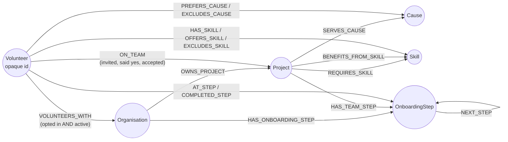

The bundled demo graph has **80 nodes and 176 relationships**: 3 organisations,
5 causes in 3 themes, 15 skills in 16 skill areas, 4 active and 2 completed projects, 10 engagements, 8 onboarding steps and 14 volunteer IDs.

### 5.4 Matching rules (implemented in Cypher)

| Condition | Result |
|---|---|
| Volunteer opted in to the project's organisation **and** is active; the project is active | The pair is considered |
| Project serves a cause the volunteer excluded, or requires a skill they excluded | The pair is **excluded**, even if another skill matches |
| Volunteer has **and** offers at least one required skill | They are a candidate |
| Volunteer prefers the project's cause | Ranked first |
| Volunteer excludes an optional skill | That skill is left out of scoring; the pair stays |
| A required skill has no eligible volunteer in the organisation | A **coverage gap** is shown |

Ranking is deterministic: preferred cause first, then required skills covered, then optional
skills offered, then stable IDs. Reads are capped at `GRAPH_MAX_ROWS` (500 by default); hitting
the cap raises `GraphTruncated` rather than silently returning partial results. The store binds
the query's `LIMIT` itself, so no caller can ask for fewer rows and mistake them for all of them.
The placement sweep reads one project or one volunteer at a time, so the cap applies to each of
those and not to an organisation as a whole.

---

## 6. Security, identity and access control

### 6.1 Identity

| Control | Implementation |
|---|---|
| Password storage | Argon2id; equal-time checks for unknown emails |
| Web sessions | Opaque random token in an HttpOnly, SameSite=Lax cookie (Secure over HTTPS); only its SHA-256 is stored; revocable; 12 h TTL |
| API sessions | Bearer tokens of a separate session kind; no cookies, so CSRF does not apply |
| CSRF | A token per session for signed-in forms, and a double-submit cookie for anonymous forms |
| Headers | Strict CSP on pages, with a narrow relaxation for `/api/docs` only |
| Concurrency | Optimistic versions on profiles, statuses, submissions and placements, so stale writes get 409 |
| Graph privacy | No PII in Relate or AuraDB; volunteers are uuid5 opaque IDs |
| Production guards | Demo seeding refuses `APP_ENV=production`; the app refuses to start on a DB holding any demo account: every address in the fixture, and anything at `@cyberscallywags.uk` |

### 6.2 Roles (RBAC)

| Role | Scope | Granted by | Can |
|---|---|---|---|
| **System admin** | All organisations | Another admin, or the seed | Everything: users, roles, organisations, projection health, the graph, emails |
| **Moderator** | System | System admin | Vet volunteers: approve, request info, decline, suspend, reinstate (never themselves) |
| **Org admin** | Their organisation | System admin | Everything the reviewer and the team coordinator can do, plus: list and remove volunteers, edit the organisation's onboarding workflow and email templates, confirm its steps |
| **Reviewer** | Their organisation | System admin | Review suggestions, withdraw active projects |
| **Team coordinator** | Their organisation | System admin | Assign project leads; everything a project lead can do, for any of its projects; list its volunteers (to choose a lead). No reviewing, and no removing volunteers from the organisation |
| **Project lead** | One project | Author by default; reassigned by a team coordinator or org admin | Invite or pass over candidates from the ranked list, reopen closed placements, run the project's team onboarding, accept, suspend, reinstate and remove team members. On their own team automatically |
| **Volunteer** | Self | Signup | Edit profile, join organisations, suggest projects, answer offers, leave teams |

Signup never grants a role. Authorisation is resolved by `services.org_access`, which returns an
`Access` record (volunteer, reviewer, team_coordinator, org_admin, system_admin), and enforced by
`require_access(role=…)` and `require_active`. A refused organisation action returns **403**
with a plain-language reason. A project, submission or placement the user can't see returns
**404**, so the API doesn't confirm that it exists.

### 6.3 Permission matrix (selected actions)

| Action | Volunteer | Lead | Reviewer | Team coordinator | Org admin | Moderator | System admin |
|---|:-:|:-:|:-:|:-:|:-:|:-:|:-:|
| Edit own profile, submit for vetting | ✔ | ✔ | ✔ | ✔ | ✔ | ✔ | ✔ |
| Suggest a project (active account) | ✔ | ✔ | ✔ | ✔ | ✔ | ✔ | ✔ |
| Review a suggestion, see coverage | | | own org | | own org | | ✔ |
| Withdraw an approved or active project | | | own org | | own org | | ✔ |
| Assign a project lead | | | | own org | own org | | ✔ |
| Invite or pass over a candidate; accept, suspend, reinstate or remove a team member | | own project | | own org | own org | | ✔ |
| Edit a project's team onboarding, confirm its steps | | own project | | own org | own org | | ✔ |
| List organisation volunteers | | | | own org | own org | | ✔ |
| Remove a volunteer from the organisation | | | | | own org | | ✔ |
| Edit the organisation's onboarding workflow and email templates | | | | | own org | | ✔ |
| Vet volunteers | | | | | | ✔ | ✔ |
| Grant roles, create organisations, replay the outbox, read the audit trail | | | | | | | ✔ |

An org admin holds the reviewer and team coordinator roles of their organisation without a
separate grant. A reviewer is not a team coordinator, and a team coordinator is not a reviewer.

---

## 7. Core workflows

### 7.1 Write path: transaction, outbox and projection

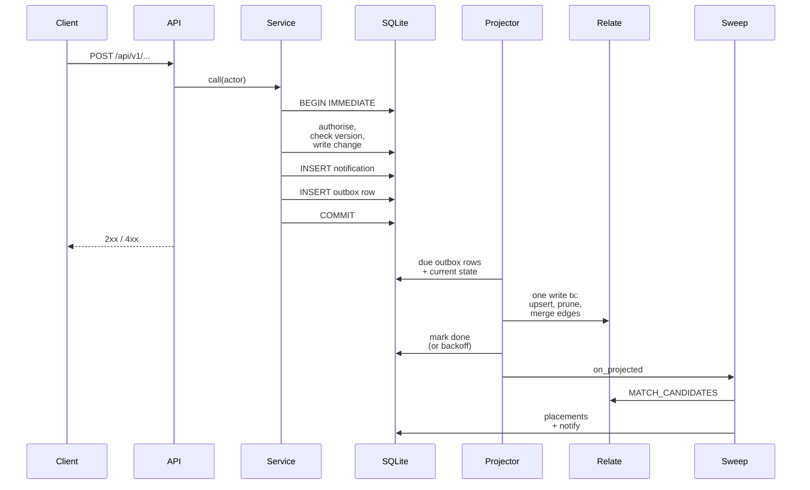

- **Idempotent:** each item reconciles to the *current* state, so replays and reordering are safe.
- **Resilient:** a failure stays queued with exponential backoff (capped at 60 s), is flagged
  after 3 attempts and is replayed at startup or from the console.
- **Fresh:** while a relevant item is pending, `matching.py` returns `Withheld` with a reason.

### 7.2 Read path: matches and coverage

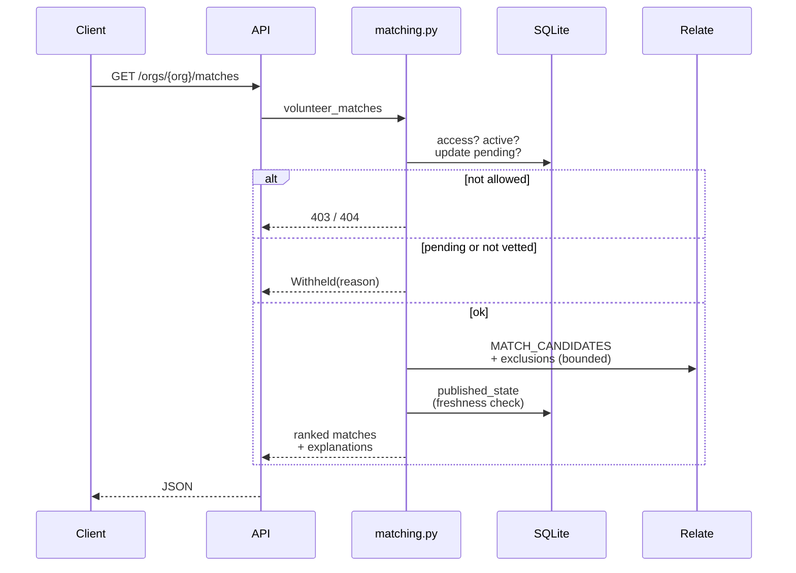

### 7.3 Volunteer onboarding, step 1: vetting

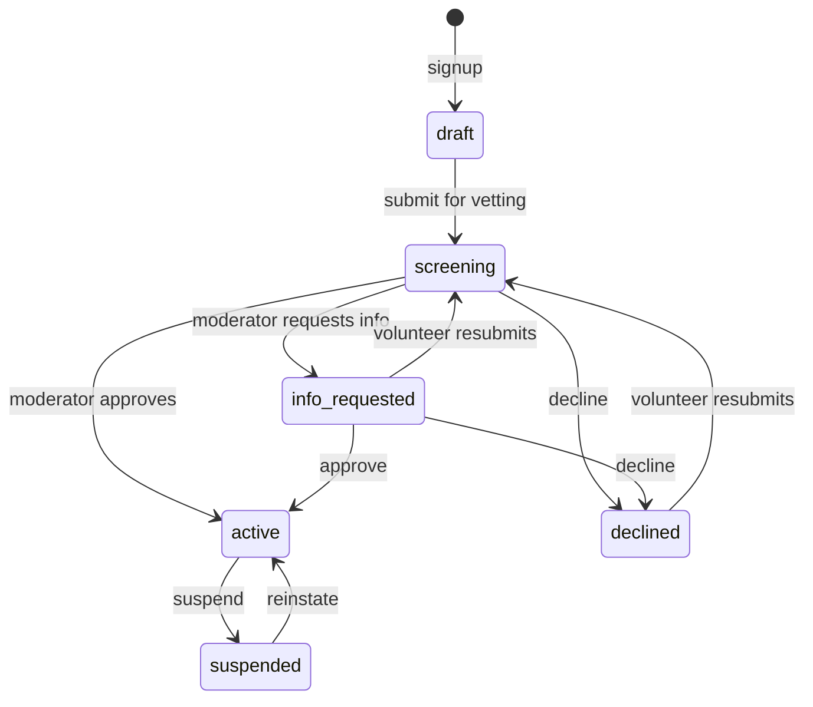

- Each transition writes a `vetting_events` row (with an optional private note), bumps
  `status_version`, notifies the volunteer and enqueues a volunteer projection.
- `VOLUNTEERS_WITH` edges exist in Relate **only while the status is active**, so an unvetted
  person can never appear in a match, however their profile looks.
- Submitting needs at least one offered skill. Moderators and admins are notified when someone
  enters screening (`notify_vetters`).

### 7.4 Volunteer onboarding, step 2: candidate to team

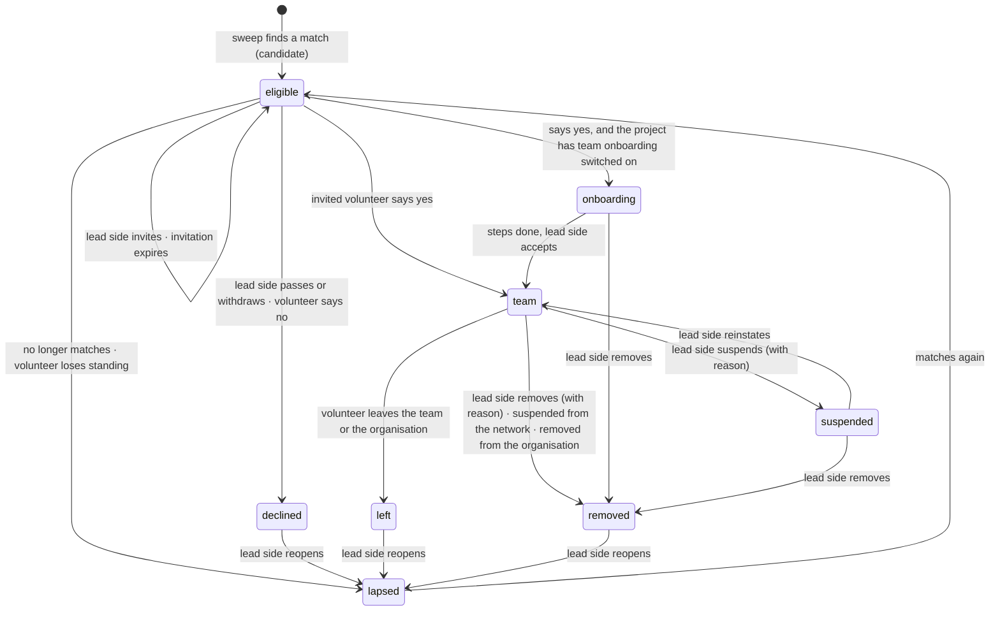

- A candidate is shown to the lead side only, ranked by preferred cause, required skills covered
  and optional skills offered. The volunteer is told when they are invited.
- The lead side is the project lead while they are active and with the organisation, or any team
  coordinator or org admin of the organisation. Their answers are interchangeable;
  `lead_actor_id` records who gave it. Nobody decides on their own place, except the lead, who is
  put on their own team by the project projection.
- Team coordinators and org admins assign the lead (`services.set_project_lead`). The new lead
  must be an active volunteer, a team coordinator or an admin of the organisation.
- A yes is re-checked against SQLite in the same transaction: the project must be published and
  the volunteer active and opted in.
- `ON_TEAM` exists in Relate only while the state is `team`: not during team onboarding, and not
  while suspended.
- A lead who loses their standing loses the lead's powers, and the organisation's team
  coordinators and org admins are told the project needs a new lead.
- An unanswered invitation is reminded once and then closes, returning the volunteer to the
  candidate list (`INVITATION_REMINDER_DAYS`, `INVITATION_EXPIRY_DAYS`).

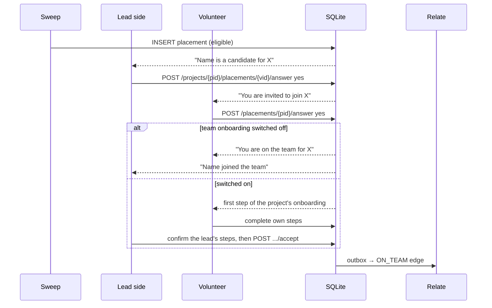

The messages in the diagram are paraphrased. The project's lead is on their own team without an
invitation. Sweeps never remove team members.

### 7.5 Project onboarding

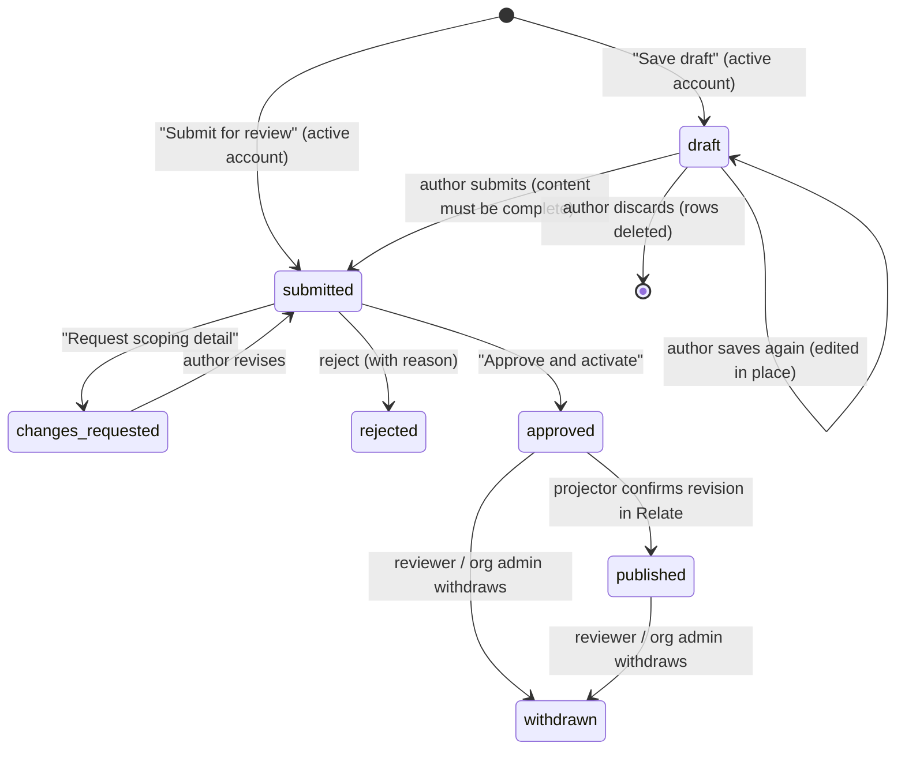

| State (DB) | Label shown | Who sees it | Visible for matching |
|---|---|---|---|
| `draft` | Draft: not yet submitted | author only | ✘ |
| `submitted` | In review | author + the organisation's reviewers | ✘ |
| `changes_requested` | Scoping: more detail requested | author + reviewers | ✘ |
| `rejected` | Rejected | author + reviewers | ✘ |
| `approved` | Approved (activating…) | author + reviewers | ✘ (until projected) |
| `published` | **Active** | the organisation | ✔ |
| `withdrawn` | Withdrawn | author + reviewers | ✘ (projection removes it; placements end) |

**The process, step by step:**

1. **Draft (optional).** An active volunteer opens *Suggest a project* and chooses **Save
   draft**. A draft needs only a title and a target organisation the author belongs to; the
   summary, cause and skills can be filled in later, but anything entered must already be valid.
   Only the author can see a draft: it is not in the review queue or its count, the
   organisation's reviewers get a 404 for it, and nobody is notified.
2. **Edit.** The author reopens the draft from *My suggestions* and saves as often as they like.
   Each save rewrites revision 1 in place and bumps `version`, so a form opened before the last
   save is refused (409). The target organisation can still be changed. **Discard draft**
   deletes it.
3. **Submit for review.** From the draft, or straight from a new form without saving a draft
   first. The content must now be complete (title, summary, cause, at least one required skill),
   and the author must still be active and belong to the organisation. If the content is not
   complete, what was typed is still saved and the draft stays a draft. On success the state
   becomes `submitted`, the author is told it is in review, and the organisation's admins are
   told there is a new suggestion.
4. **Review.** A reviewer of the organisation (never the author) requests scoping detail,
   rejects, or approves, each with a reason for the author.
5. **Scoping.** After "changes requested" the author revises and resubmits, which creates the
   next revision and puts the suggestion back in the queue.
6. **Activation.** An approved revision is written to Relate by the projector; once confirmed,
   the state is `published` and the project can be matched.
7. **Withdrawal.** A reviewer or org admin can withdraw an approved or published project; it
   leaves the graph and its placements end.

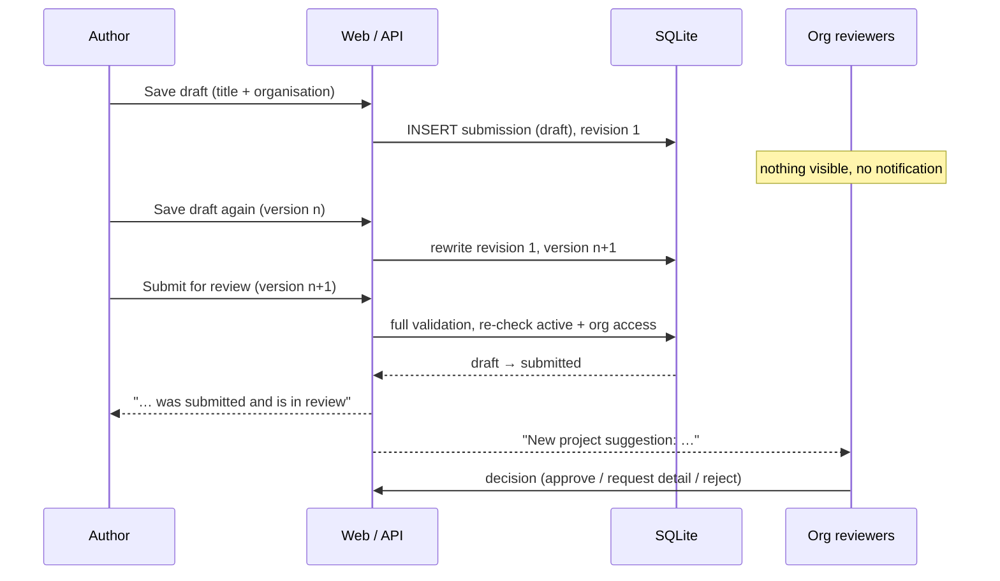

From submission onwards the author is notified at every step. Decisions and draft saves check
the state and version (decisions the revision too), so a replayed or stale form can't publish
twice or overwrite a newer draft.

### 7.6 Notifications

Every notification is written by `notify()` **inside the same transaction** as the change it
describes, so a user is never told about something that didn't happen. Clients read
`GET /notifications`, and the unread count is part of `GET /me`, shown as a badge on the web nav
and the mobile menu.

### 7.7 Assistants

Six Pydantic AI agents (`src/app/agents/`) sit on the service layer. They are a fourth client of
it, beside the pages, the API and the console, and they follow the same rules: the graph decides
who matches, SQLite holds the truth, and every change goes through a service function that
checks the caller's role. With no `AGENT_MODEL` they are switched off and nothing else changes.

| Assistant | For | Reads | Can change (only after the user approves) |
|---|---|---|---|
| `volunteer-onboarding` | a volunteer, own profile | catalogue, own profile, organisations | profile; submit for vetting |
| `project-scoping` | an active member of the organisation | catalogue, the organisation's active projects, own suggestions | a private draft |
| `project-review` | the organisation's reviewers | the suggestion and its review history, active projects | nothing |
| `match-shortlist` | the project's lead side | the project, its team, the graph's ranked candidates | an invitation |
| `match-explainer` | a volunteer, own matches | own matches and exclusions | nothing |
| `audit` | system admins | role holders, usage figures, checks, audit events | nothing |

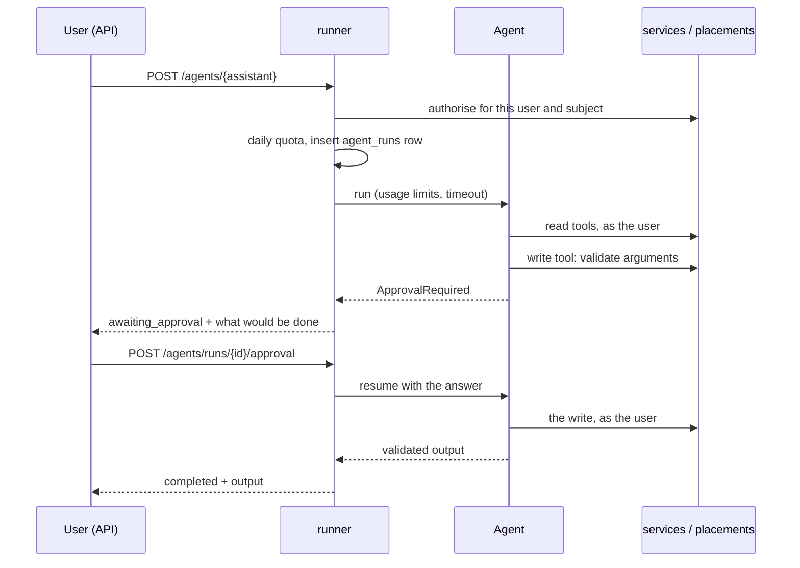

The controls are in code, not in the prompt:

- **Identity** comes from the session (`AgentDeps.actor_id`); no tool takes a user ID for "me".
- **Authorisation** runs twice: once before the model is asked anything, and again inside every
  tool, because each tool calls the same service function as the API.
- **Approval**: a write tool validates its arguments, then raises `ApprovalRequired`. The run
  stops with its conversation stored; only the person who started it can answer, once. The
  conversation is deleted when the run ends, or after two days unanswered.
- **Grounding**: output validators re-read the data and reject any skill, cause, person or
  project the application did not return, and any change to an exclusion. A shortlist's
  remaining gaps and the audit's overall verdict are computed.
- **Limits**: requests, tool calls, tokens and wall-clock time per run; runs per account per day.
- **The audit assistant is a `pydantic_graph` pipeline**: three steps of plain code gather the
  role holders, the usage figures and the checks, and only the fourth asks the model.

### 7.8 Audit trail

`audit_log` records who did what and whether it was allowed (`src/app/audit.py`):

- role grants and removals, in the transaction that makes them;
- every request that changes something and every request that is refused, written by the web
  app's middleware with the acting account, the route as declared and the outcome;
- sign-ins, and assistant runs, approvals and refused tool calls.

A row describes an action, never its content: no email address, password or form text. From the
trail and the role tables the application derives **checks** it can prove: a suspended or
declined account that still holds a role, an organisation with no admin, a single system admin,
an account refused repeatedly, a burst of failed sign-ins, a self-granted role, an assistant that
keeps failing. System admins read all of this in the console's Audit section or under
`/admin/audit/*`; `python -m app.cli audit` prints the checks. `agent_runs` holds one row per
assistant run: who, which assistant, tokens, tools called, how it ended, and its trace ID.

### 7.9 Observability and evaluation

`src/app/observability.py` configures Pydantic Logfire once per process. A request is one trace:
the HTTP span, the assistant run, each model request and tool call, and the placement sweep.
Counters cover audit events and assistant runs, with a histogram of tokens per run. Request
headers, bodies and endpoint arguments are not recorded, and prompts and model output are left
off the spans in production unless `LOGFIRE_INCLUDE_CONTENT` is set.

Evaluation happens in two places. **Online**, two deterministic evaluators run in the background
on every live run and report on the run's own trace: no contact details in an output, and a
reason with every suggestion. **Offline**, `python -m app.cli evals` runs each assistant's
dataset against a disposable copy of the demo with the configured model and exits 1 if an
assertion fails, so it can gate a change of model or instructions.

### 7.10 Onboarding workflows and email

Vetting (7.3) is done once for the whole network. On top of it, an organisation can have its
own workflow for volunteers who join it, and a project can have one for volunteers joining its
team (`services/onboarding.py`). Both are ordered steps, each completed either by the volunteer
or by the other side, and each optionally announced by an email.

| | Organisation's workflow | Project's team workflow |
|---|---|---|
| Edited by | Org admins (console *Onboarding* section, or the API) | The lead side: lead, team coordinators, org admins (project page, or the API) |
| Started by | Joining the organisation while it is switched on | Saying yes to an invitation while it is switched on |
| Steps confirmed by | The volunteer, or an org admin | The volunteer, or the lead side |
| Ends with | The run is complete | The lead side accepts the volunteer onto the team |
| Cancelled by | Leaving or being removed from the organisation | Leaving or being removed from the team |

- A new organisation gets a two-step starter workflow, switched off. Switching one on applies
  to people who join from then on.
- The organisation's workflow comes first: a volunteer part-way through it cannot say yes to a
  team invitation, be accepted or be reinstated.
- Every edit bumps the workflow's `version`, so a stale editor is refused (409).
- Email templates belong to the organisation and are written by its org admins only. They are
  plain text with placeholders from a fixed list (`mailer.PLACEHOLDERS`); anything else in curly
  brackets is refused when the template is saved.
- An email is a row in `email_outbox`, written in the same transaction as the step it
  announces. The web process delivers the queue over SMTP in its background loop, retrying a
  failure five times with a growing delay. With no `SMTP_HOST` nothing is sent and the row is
  marked `not_configured`. In Compose the relay is Mailpit, which delivers nothing onwards.
- Org admins see recipients by name; the address is read only when the message is sent.
- Steps and progress are projected to Relate through the same outbox as everything else
  (`OnboardingStep` nodes, `NEXT_STEP`, `AT_STEP`, `COMPLETED_STEP`). The onboarding assistant
  reads them there. Templates and addresses stay in SQLite.
- A workflow does not change who is matched: the matching query is unchanged.

---

## 8. API surface

Interactive documentation: **`/api/docs`** (OpenAPI at `/api/openapi.json`). Errors are JSON:
422 invalid, 403 forbidden, 404 not found or not visible, 409 conflict or stale version, 503
graph busy or assistants not configured, 429 assistant quota used, 502 assistant run failed.

| Tag | Endpoints |
|---|---|
| **auth** | `POST /auth/signup` · `POST /session` · `DELETE /session` |
| **me** | `GET /me` · `PUT /me/active-org` · `GET/PUT /profile` · `POST /me/vetting` · `GET /notifications` · `POST /notifications/{id}/read` · `POST /notifications/read-all` |
| **organisations** | `GET /orgs` · `PUT/DELETE /orgs/{org}/membership` · `GET /orgs/{org}/matches` · `GET /orgs/{org}/projects` · `GET /orgs/{org}/coverage` · `GET /orgs/{org}/volunteers` · `POST /orgs/{org}/volunteers/{uid}/remove` |
| **projects** | `GET/POST /submissions` · `POST /submissions/drafts` · `PUT /submissions/{sid}/draft` · `POST /submissions/{sid}/submit` · `GET/DELETE /submissions/{sid}` · `POST /submissions/{sid}/revisions` · `GET /orgs/{org}/submissions` · `POST /orgs/{org}/submissions/{sid}/decision` · `POST /orgs/{org}/projects/{sid}/withdraw` · `PUT /orgs/{org}/projects/{sid}/lead` |
| **placements** | `GET /placements` · `POST /placements/{pid}/answer` · `POST /placements/{pid}/leave` · `GET /projects/{pid}/placements` · `POST /projects/{pid}/placements/{vid}/answer` · `POST .../{vid}/reopen` · `POST .../{vid}/accept` · `POST .../{vid}/suspend` · `POST .../{vid}/reinstate` · `POST .../{vid}/remove` |
| **moderation** | `GET /moderation/volunteers` · `GET /moderation/volunteers/{uid}` · `POST /moderation/volunteers/{uid}/decision` |
| **onboarding** | `GET /me/onboarding` · `POST /orgs/{org}/onboarding/steps/{step}/complete` · `GET/PUT /orgs/{org}/onboarding` · `POST /orgs/{org}/onboarding/steps` · `PUT/DELETE /orgs/{org}/onboarding/steps/{step}` · `POST .../steps/{step}/move` · `POST /orgs/{org}/onboarding/templates` · `PUT/DELETE .../templates/{template}` · `POST .../templates/preview` · `POST .../templates/{template}/test` · `GET /orgs/{org}/onboarding/volunteers` · `POST .../volunteers/{uid}/steps/{step}/complete` · `GET /orgs/{org}/onboarding/emails`; and the same steps and volunteers routes for a project's team onboarding under `/orgs/{org}/projects/{pid}/onboarding` |
| **assistants** | `GET /agents` · `POST /agents/volunteer-onboarding` · `POST /agents/project-scoping` · `POST /agents/project-review` · `POST /agents/match-shortlist` · `POST /agents/match-explainer` · `POST /agents/audit` · `POST /agents/runs/{run}/approval` · `GET /agents/runs` · `GET /agents/runs/{run}` |
| **audit** | `GET /admin/audit/events` · `GET /admin/audit/rbac` · `GET /admin/audit/usage` · `GET /admin/audit/checks` |
| **admin** | `GET /admin/users` · `PUT/DELETE /admin/users/{uid}/system-roles/{role}` · `PUT/DELETE /admin/orgs/{org}/roles/{uid}/{role}` · `POST /admin/orgs` · `GET /admin/projection` · `POST /admin/projection/replay` · `GET /admin/graph` |

All paths are prefixed with `/api/v1`.

### Client coverage

| Capability | Web | Mobile | Admin console |
|---|:-:|:-:|:-:|
| Sign in / sign up | ✔ | ✔ (sign in) | ✔ (staff) |
| Profile: onboarding card, skills by type, causes, active and past projects | ✔ | ✔ | |
| Matches and coverage | ✔ | ✔ | coverage |
| Suggest and revise projects | ✔ | ✔ | |
| Opportunities (answer offers, leave teams) | ✔ | ✔ | |
| Notifications | ✔ | ✔ | |
| Review queue, candidates and team, volunteers | ✔ | | ✔ |
| Own onboarding steps | ✔ | | |
| Project team onboarding (steps, accept, suspend) | ✔ | | ✔ (org admins) |
| Organisation onboarding workflow, email templates, sent emails | | | ✔ |
| Volunteer screening | | | ✔ |
| Users, roles, organisations, projection, graph | | | ✔ |

The web and mobile profile pages share one structure from `profile_view.overview`: an
onboarding card, then accordions for Skills (with sub-accordions per skill type), Causes,
Active projects and Past projects.

---

## 9. Functions by module

### `auth.py`
`normalise_email`, `hash_password`, `token_hash`, `signup`, `authenticate`, `create_session`,
`load_session`, `revoke_session`, `set_active_org`, `csrf_matches`.

### `services/`
A package with one module per area. Callers import every name from the package itself.

- **`errors.py`:** `NotFound`, `Forbidden`, `Conflict`, `Invalid`, `require_reason`.
- **`access.py`:** `Actor`, `load_actor`, `get_actor`, `Access`, `org_access` (one query),
  `check_access`, `require_access`, `require_active`, `require_admin`, `require_vetter`,
  `directory`, `load_directory`, `accessible_orgs`.
- **`orgs.py`:** `set_membership`, `org_volunteers`, `remove_volunteer`, `create_organisation`.
- **`vetting.py`:** `submit_for_vetting`, `vetting_queue`, `vetting_record`, `vet_volunteer`.
- **`roles.py`:** `set_system_role`, `set_org_role`, `list_users`.
- **`profile.py`:** `get_profile`, `update_profile`, `skill_flags`, `skill_state`, and the
  skill-state and cause-stance labels.
- **`submissions.py`:** `create_submission`, `revise_submission`, `get_submission`,
  `my_submissions`, `review_queue`, `review_counts`, `review_submission`, `withdraw_project`,
  `set_project_lead`, `published_state`, and the project-state labels.
- **`teams.py`:** `in_standing`, `lead_in_standing`, `check_lead_side`, `notify_deciders`,
  `ensure_lead_on_team`, `end_for_volunteer`, `flag_leaderless`, `record`.
- **`onboarding.py`:** `get_workflow`, `update_workflow`, `add_step`, `update_step`, `move_step`,
  `delete_step`, `save_template`, `delete_template`, `preview_template`, `send_test`,
  `sent_emails`, `start`, `cancel`, `complete_step`, `my_onboarding`, `org_progress`.

### `placements.py`
`sweep` (Relate matches to placements; given a `Scope`, only the volunteers and projects that
changed), `volunteer_respond`, `lead_respond`, `reopen`, `chase` (reminders and expiry),
`accept`, `suspend`, `reinstate`, `end_team_membership`, `for_volunteer`, `for_project`,
`lead_side`.

### `matching.py`
`volunteer_matches`, `project_coverage`, `browse`, `project`, plus helpers that check for pending updates
and build explanations.

### `notify.py`
`notify`, `notify_org_admins`, `notify_vetters`, `list_for`, `unread_count`, `mark_read`.

### `mailer.py`
`template_problems`, `render`, `queue`, `deliver`; the fixed list `PLACEHOLDERS`.

### `profile_view.py`
`overview`: skills grouped by type, causes, and active and past projects with labels.

### `graph/`
- **`store.py`:** `GraphStore.write()`, `.reader()`, `.read()`; errors `GraphError`, `GraphBusy`,
  `GraphTruncated`.
- **`projector.py`:** `Projector.drain()`, `.status()`, the `on_projected` hook (told what
  changed), `pending_for`.
- **`cypher.py`:** `MATCH_CANDIDATES`, `COVERAGE_GAPS`, `EXCLUDED_FOR_VOLUNTEER`,
  `OPTIONAL_SKILLS_EXCLUDED`, `BROWSE_PROJECTS`, `TEAM_COVERAGE`, `INSPECT`, the relationship schema
  (`RELATIONSHIPS`) and the reconcile statements generated from it.
- **`aura.py`:** `push` (scoped to `dvn-demo-v1`) and `parity`.

### `runtime.py` and `cli.py`
- **`runtime.py`:** `build_runtime`, `bootstrap`, `seed_catalogue`, `seed_demo` (which forms the
  team through the real accept flow), `reset_demo`.
- **`cli.py` commands:** `reset`, `bundle`, `inspect`, `matches`, `status`, `drain`,
  `grant-reviewer`, `openapi`, `brand`, `about`, `contributors`, `aura-push`, `aura-parity`,
  `evals`, `audit`.

### `agents/`, `audit.py` and `observability.py`
- **`agents/runner.py`:** `start`, `resume`, `my_runs`, `get_run`; the registry of assistants.
- **`agents/deps.py`:** `AgentDeps`, `build_model`, the tool guard, the shared toolsets.
- **`agents/onboarding.py`, `projects.py`, `match.py`, `audit.py`:** one agent each (two in
  `projects.py` and `match.py`), with its tools, output type and output validator.
- **`agents/evaluators.py`, `evals.py`:** the evaluators, the online capability, the datasets.
- **`audit.py`:** `record`, `list_events`, `rbac_snapshot`, `usage_summary`, `checks`.
- **`observability.py`:** `configure`, `instrument_app`, `span`, the counters.

---

## 10. Deployment and operations

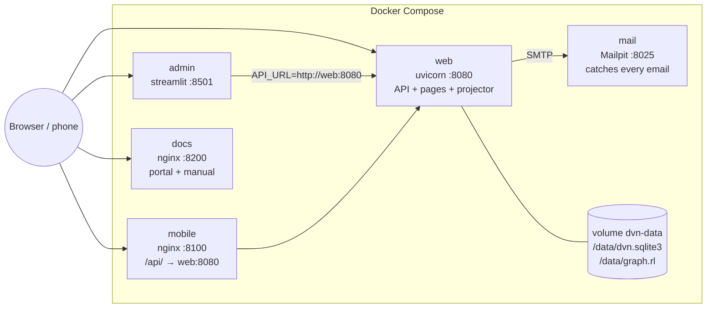

| Path | Commands |
|---|---|
| **Clean start with uv** | `uv sync --locked` → `uv run task reset` → `uv run task web` (+ `uv run task admin`) |
| **Clean start with Compose** | `docker compose up --build` (ports configurable with `WEB_PORT`, `ADMIN_PORT`, `MOBILE_PORT`, `DOCS_PORT`) |
| **Reset demo** | `uv run task reset` or `docker compose down -v` |
| **Inspect graph** | `uv run task inspect`, `relate ...` on `var/graph.rl`; see [Relate in this application](relate.md) |
| **Projection health** | `python -m app.cli status` / `drain`, or the console's *System* section |
| **AuraDB** | `python -m app.cli aura-push` then `aura-parity` (needs `AURA_*` credentials) |

**Configuration** (env or `.env`): `DATA_DIR`, `ORG_NAMES`, `SESSION_TTL_HOURS`, `SIGNUP_ENABLED`,
`COOKIE_SECURE`, `TRUST_PROXY_HEADERS`, `API_URL`, `PROJECTOR_INTERVAL_SECONDS`,
`SEED_DEMO_ON_START`, `GRAPH_MAX_ROWS`, `INVITATION_REMINDER_DAYS`, `INVITATION_EXPIRY_DAYS`,
`SMTP_HOST` / `SMTP_PORT` / `SMTP_USERNAME` / `SMTP_PASSWORD` / `SMTP_STARTTLS`, `EMAIL_FROM`, `PUBLIC_URL`, `AURA_URI` / `AURA_USERNAME` / `AURA_PASSWORD` / `AURA_DATABASE`, `APP_ENV`; for the assistants `AGENT_MODEL`, `AGENT_FALLBACK_MODEL`, `ANTHROPIC_API_KEY`, `AGENT_REQUEST_LIMIT`, `AGENT_TOOL_CALLS_LIMIT`, `AGENT_TOTAL_TOKENS_LIMIT`, `AGENT_TIMEOUT_SECONDS`, `AGENT_DAILY_RUNS`; and `LOGFIRE_TOKEN`, `LOGFIRE_INCLUDE_CONTENT`, `AUDIT_RETENTION_DAYS`. [Tooling](tooling.md) gives the
default and meaning of each.

**Schema changes:** `PRAGMA user_version` must equal `SCHEMA_VERSION` (9), or the app stops with
a `SchemaOutdated` message pointing to the reset commands. The demo data is disposable, so there
are no migrations.

---

## 11. Quality and verification

| Check | Result |
|---|---|
| `ruff check` / `ruff format --check` | Clean, 119 files |
| `pytest` | 365 tests: 363 run locally, 2 gated (AuraDB without credentials; Compose). The last recorded full run is in the verification record |
| RBAC and onboarding suite | 15 tests (`tests/test_rbac_onboarding.py`) |
| Relate persistence | Write, close, reopen and assert (`tests/test_relate_store.py`) |
| Mobile | Lint OK, **39 tests**, production build OK |
| Admin console | 18 tests as system admin, moderator, org admin and volunteer: correct sections, decisions recorded, errors shown |
| Compose | Built and smoke-tested on alternate ports; `/api/docs` returns 200 |
| Lockfile | `uv lock --check` OK |
| AuraDB | **Not verified**: no credentials available |

Details are in [verification.md](verification.md).

---

## 12. Architecture decisions

| # | Decision | Alternatives considered | Rationale |
|---|---|---|---|
| AD-1 | SQLite as the source of truth, Relate as a projected read model | Graph as the only store | Transactions, constraints and auditable history for identity and workflow; the graph stays PII-free |
| AD-2 | Transactional outbox with idempotent reconcile | Dual writes; change-data capture | No lost or partial updates; safe replay after a crash; order-independent |
| AD-3 | Withhold results while an update is pending | Show possibly stale matches | Prevents suggesting an excluded cause or a withdrawn project |
| AD-4 | Open Relate per unit of work with a lock and bounded retry | One long-lived connection | Relate's exclusive lock would block the CLI and inspection tools |
| AD-5 | Opaque, hashed sessions | JWT | Instant revocation; nothing to forge or leak from storage |
| AD-6 | Admin console and mobile app as pure API clients | Direct DB access | One authorisation path; the console holds no special privileges |
| AD-7 | 404 for projects and submissions a user can't see; 403 with a reason for refused organisation actions | 403 everywhere | Doesn't reveal hidden projects, and still tells members why an action was refused |
| AD-8 | Cypher in the Neo4j 5 dialect | Relate-specific syntax | Lets the same queries run on AuraDB for the parity check |
| AD-9 | AuraDB is explicit, off the request path | Live sync | Optional, credential-gated, no effect on the demo's availability |

---

## 13. Limitations and next steps

| Area | Current state | Next step |
|---|---|---|
| Notifications | In-app, plus onboarding emails over SMTP | Email or push for the other notifications, from the same outbox |
| Scale | Single process; Relate locks exclusively | A separate projector worker; read replicas or AuraDB for heavy reads |
| Web pages | Call services in-process | Optionally route them through the API as well |
| AuraDB | Push and parity built, not verified | Run with credentials and record parity output |
| Migrations | Reset on schema change | Add migrations before any real data |
| Mobile | Browser build served by nginx | Capacitor native builds, offline cache |
| Observability | Logfire traces and counters; projection status | Metrics for outbox lag and Relate lock waits |
| Assistants | JSON API, and the audit assistant in the console; verified with stand-in models only | Run the evals against a real model; add panels to the web pages and the mobile app |
| Sign-in | Failed attempts are audited and a burst is a check | A lock-out or rate limit |
